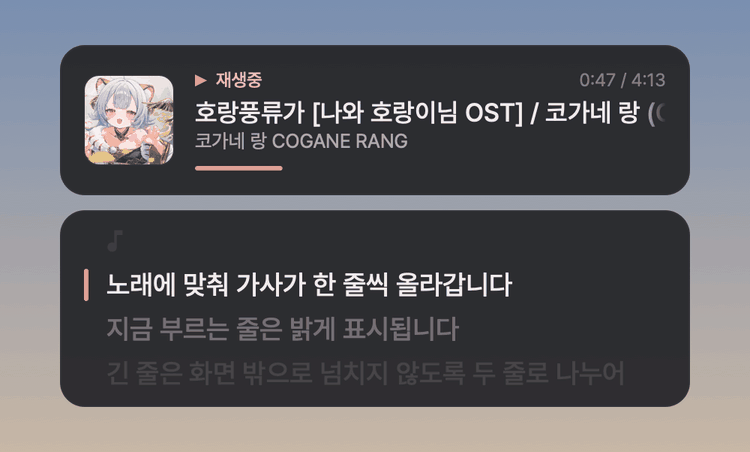
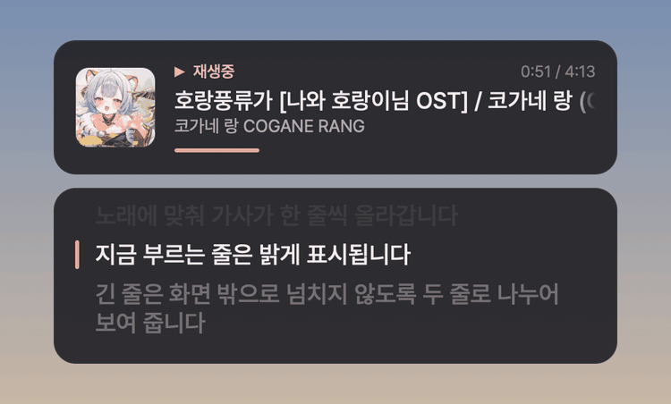
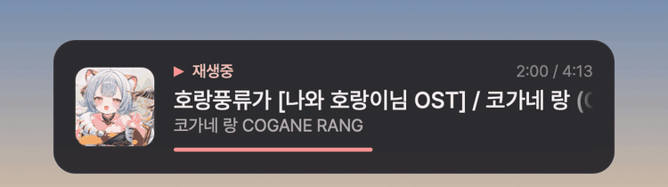

<h1 align="center">Now Playing Widget</h1>

  <a href="README.md">English</a> · <a href="README.ko.md">한국어</a> · <b>日本語</b>

  YouTube Music の同期歌詞を、どんな画面の上にも表示するオーバーレイウィジェットです。 
  <b>「歌ってみた」などのカバー曲では、原曲の歌詞を探して表示します。</b>

  
  
  

  

Now Playing Widget は、YouTube Music で再生中の曲を画面の隅に表示します。アルバムアート、タイトル、アーティスト、進行バーに加えて、歌詞のある曲では、曲に合わせてスクロールする歌詞カードも表示します。**Web ブラウザ**(Chrome、Edge、Safari など)で再生する YouTube Music と、[Pear Desktop](https://github.com/pear-devs/pear-desktop)(YouTube Music のデスクトップアプリ)の両方に対応しており、Windows 10/11 と macOS 13 以降で使えます。

- **カバー曲にも歌詞を表示します。** カバー曲(歌ってみた など)を再生すると、原曲を探してその同期歌詞を表示します。詳しくは[カバー曲の歌詞](#カバー曲の歌詞)をご覧ください。
- **ブラウザ拡張機能は必要ありません。** アプリを起動してブラウザで YouTube Music を再生すれば、すぐに表示されます。
- **どんな画面の上にも表示されます。** フルスクリーンのゲーム、動画、作業中のウィンドウの上に表示され、クリックやキー入力はウィジェットの下にあるウィンドウにそのまま届きます。
- **グローバルホットキー**で、前の曲、次の曲、再生/一時停止を操作できます。
- **ほかにインストールするものはありません。** Windows 版は、Windows に標準で入っている .NET Framework 4.8 で動作します。
- **アップデートは、ボタンを押したときだけインストールします。** 新しいバージョンが出るとアプリが知らせ、メニューから押すとダウンロードしてインストールします。

> [!NOTE]
> アプリのメニューと状態表示は、現在のところ韓国語のみです。このページでは、メニューで探せるように、韓国語の表記を日本語の意味と並べて書いています。

[カバー曲の歌詞](#カバー曲の歌詞) · [インストール](#インストール) · [機能](#機能) · [メニュー](#メニュー) · [アップデート](#アップデート) · [設定ファイル](#設定ファイル) · [トラブルシューティング](#トラブルシューティング) · [詳しい動作](#詳しい動作) · [通信先](#通信先)

## カバー曲の歌詞

歌詞データベースには原曲を基準に歌詞が登録されているため、通常の動画として投稿されたカバー曲には歌詞がないことがほとんどです。Now Playing Widget はカバー曲の原曲を探し、**原曲の同期歌詞**を代わりに表示します。歌ってみた動画は原曲のオケをそのまま使うことが多いので、タイミングもよく合います。

| 再生している曲 | 表示する歌詞 |
|---|---|
| アルバム曲(公式音源) | その曲の同期歌詞 |
| MV | 同じアーティストの公式音源の歌詞 |
| カバー曲(歌ってみた など) | **原曲**の同期歌詞 |
| リミックス、アレンジ、アコースティック、ショート ver. | タイミングが合わないため、原曲の歌詞は使いません。 |

### 原曲の探し方

1. **動画の概要欄のリンク**: 「原曲」「本家」「original」「원곡」などの表記が付いたリンクを最初に確認します。Mix、Off Vocal、イラストのリンクは飛ばします。
2. **YouTube 検索**: 使えるリンクがなければ、曲名で YouTube を検索し、公式アーティストチャンネルや「- Topic」チャンネルにある原曲の動画を探します。同じ名前の別の曲があって原曲を一つに決められない場合は、どれも選びません。
3. **タイトルと概要欄の文章**: それでも見つからなければ、動画のタイトルと概要欄から曲名と原曲者を読み取り、LRCLIB で探します。たとえば `ワールドイズマイン / ryo(covered by …)` からは「ワールドイズマイン」と「ryo」を読み取ります。

### 原曲の歌詞を使わない場合

タイミングのずれた歌詞は表示しないほうがよいため、次の場合は原曲の歌詞を使いません。

- タイトルに remix、arrange、アレンジ、편곡、acoustic、弾き語り、piano ver、short ver などの語が含まれている場合
- 動画の長さが原曲と 10 秒を超えて違う場合

### カバー曲ごとにタイミングを合わせる

カバー曲のオケが原曲と少しずれているときは、メニューの **歌詞 → この曲の歌詞タイミング**(`가사 → 이 곡 가사 타이밍`)で 0.1 秒単位で調整します。この値は動画ごとに記憶されるので、一度合わせれば次回からそのまま使われます。

### 知っておくとよいこと

- メニューの一番上にある歌詞の状態に、`(YouTube Music · 원곡)`(YouTube Music にある原曲の歌詞)や `(LRCLIB · 원곡 검색)`(検索で見つけた原曲の、LRCLIB の歌詞)のように歌詞の出どころが表示されます。
- この機能は beta で、最初からオンになっています。アルバム曲だけで歌詞を探したい場合は、メニューの **歌詞 → カバー曲の歌詞を表示 (beta)**(`가사 → 커버곡 가사 표시(beta)`)をオフにします。

## インストール

### Windows

1. [Releases](https://github.com/Roena0516/now-playing-widget/releases/latest) から、名前が `NowPlayingWidget-Windows` で始まる zip ファイルをダウンロードして展開します。
2. `NowPlayingWidget.exe` を実行します。タスクバー右側のトレイに音符のアイコンが表示されます。
3. ブラウザで YouTube Music(`music.youtube.com`)を再生すると、画面の左下に曲の情報が表示されます。

> コード署名をしていないため、初回の起動時に「Windows によって PC が保護されました」というウィンドウが出ることがあります。その場合は **詳細情報 → 実行** を押します。
> Windows の起動時に自動で実行するには、`Win + R` で `shell:startup` フォルダを開き、exe のショートカットを入れます。

### macOS

1. [Releases](https://github.com/Roena0516/now-playing-widget/releases/latest) から、名前が `NowPlayingWidget-macOS` で始まる DMG ファイルをダウンロードして開きます。
2. `Now Playing Widget.app` を `Applications` フォルダにドラッグして実行します。メニューバーに音符のアイコンが表示されます。
3. ブラウザで YouTube Music を再生します。初回は、「Now Playing Widget」がブラウザ(たとえば「Google Chrome」)を制御してよいかを macOS が確認するので、**許可**(または **OK**)を押します。この確認はブラウザごとに一度だけ表示され、別の画面に出ることもあります。

> Apple の公証を受けていないため、初回は開けないことがあります。その場合は **システム設定 → プライバシーとセキュリティ** で **このまま開く** を押します。ビルド方法と詳細は [macOS ガイド](macos/README.md)(韓国語)にあります。

### Pear Desktop も使う場合

設定は最初の一度だけです。

1. Pear Desktop のメニューで **プラグイン → APIサーバー(Beta)** をオンにします。**ホスト名**は `127.0.0.1` に変更することをおすすめします(`0.0.0.0` のままだと、同じネットワーク上の他の機器も接続を試みることができます)。**ポート**(`26538`)と**許可方法**は既定値のままにします。
2. ウィジェットのメニューで **Pear Desktop に接続をリクエスト**(`Pear Desktop 연결 요청`)を押します。
3. Pear Desktop に、`pear-now-playing` のアクセスを許可するかどうかを確認する「API承認リクエスト」のウィンドウが表示されるので、**許可**を押します。それ以降は、ウィジェットを起動すると自動で接続されます。

ウィジェットは、手順 2 のメニューを押すまで Pear Desktop に接続をリクエストしません。1.9.4 以前ですでに接続している場合は、もう一度押す必要はありません。

## 機能

### 曲カード

アルバムアート、タイトル、アーティスト・アルバム、進行バーを表示します。曲や再生状態が変わると数秒間表示されて消えますが、**曲情報を常に表示**(`곡 정보 계속 표시`、既定でオン)で表示したままにできます。一時停止すると、表示がグレーに変わります。

  

### 同期歌詞

- 最初に YouTube Music の歌詞を探し、なければ [LRCLIB](https://lrclib.net)、その次に Kugou と NetEase(网易云音乐)で探します。
- カバー曲では**原曲の歌詞**を表示します。詳しくは[カバー曲の歌詞](#カバー曲の歌詞)をご覧ください。
- 曲の再生中に次の曲の歌詞を先に探しておくので、次の曲が始まるとすぐに歌詞が表示されます。
- 今歌っている行を明るく表示し、行が変わるとなめらかに上へスクロールします。長い行は 2 行に分けて表示します。
- 歌詞が歌より早い、または遅い場合は、メニューの **この曲の歌詞タイミング**(`이 곡 가사 타이밍`、この動画のみ)か **すべての曲の歌詞タイミング**(`모든 곡 가사 타이밍`)で 0.1 秒単位で調整します。

詳しい順序とルールは、下の[詳しい動作](#詳しい動作)にあります。

### 長いタイトル

タイトルがカードより長いと、電光掲示板のように横へ流れます。最初の 1.8 秒は先頭部分を表示し、末尾が通り過ぎると先頭が続けて入ってきます。

  

### ブラウザと Pear Desktop

メニューの **再生アプリ**(`재생 앱`)で、曲を取得する場所を選びます。

| 再生アプリ | 動作 |
|---|---|
| **自動(ブラウザ、Pear Desktop)**(`자동 (브라우저, Pear Desktop)`、既定) | 両方を確認し、後から再生を始めたほうの曲を表示します。 |
| **ブラウザ**(`브라우저`) | ブラウザの YouTube Music だけを表示します。 |
| **Pear Desktop** | Pear Desktop だけを表示します(1.9.4 までと同じ動作)。 |

対応ブラウザは、Windows では Chrome、Edge、Brave、Whale、Vivaldi、Opera、Firefox、macOS では Chrome、Edge、Brave、Arc、Whale、Vivaldi、Opera、Safari、Firefox です。ブラウザで聴いているときは、シャッフルやラジオの次の曲を事前に知ることができないため、その場合は曲が始まったときに歌詞を探します。

### Discord のステータス

メニューの **Discord → 「聴いています」を表示**(`Discord → 듣는 중 표시`)をオンにすると、聴いている曲を Discord のプロフィールに表示します。最初はオフです。

- 曲のタイトル、アーティスト、アルバムアート、進行バーを表示します。タイトルやアルバムアートを押すと、その曲が YouTube Music で開きます。
- このアプリの GitHub ページへ移動する **Now Playing Widget** ボタンも表示します。**GitHub ボタンを表示**(`GitHub 버튼 표시`)でオフにできます。
- ブラウザと Pear Desktop の両方の曲を表示し、一時停止すると表示を消します。
- Discord の**デスクトップアプリ**が起動している必要があります。ブラウザで開く Discord(Web 版)には表示できません。

### 位置、サイズ、複数のモニター

- ウィジェットの位置を画面の 6 か所から選ぶか、**ウィジェットをドラッグして移動**(`위젯 끌어서 옮기기`)で好きな場所に置きます。
- サイズは 4 段階、透明度(文字を含む)は なし・20%・40%・60% から選びます。
- 複数のモニターに同時に表示でき、モニターごとに位置、サイズ、透明度を変えられます。
- 韓国語、英語、日本語を **Pretendard JP** フォント一つで表示します。

### ホットキー

| ホットキー | 機能 |
|---|---|
| `Ctrl + Alt + ↑` | 今の曲をもう一度表示 |
| `Ctrl + Alt + ↓` | 再生 / 一時停止 |
| `Ctrl + Alt + →` | 次の曲 |
| `Ctrl + Alt + ←` | 前の曲 |
| `Ctrl + Alt + P` | 「曲情報を常に表示」のオン/オフ |
| `Ctrl + Alt + L` | 歌詞表示のオン/オフ |

他のアプリを使っている間も動作します。macOS では `Ctrl` が Control、`Alt` が Option キーです。他のキーの組み合わせは設定ファイルで変更します。

## メニュー

トレイアイコンを右クリックするとメニューが表示されます(macOS ではメニューバーのアイコンをクリックします)。Windows では、アイコンをダブルクリックすると今の曲が表示されます。

| 項目 | 韓国語の表記 | 説明 |
|---|---|---|
| アプリ名とバージョン、**アップデートを確認**ボタン | `업데이트 확인` | 一番上にあります。ボタンを押すと、メニューを開いたまま確認し、結果(`최신 버전`、最新バージョン)をボタンに表示します。新しいバージョンがあるとボタンが `(バージョン) 설치`(インストール)に変わり、押すとインストールします。 |
| 状態の行 | | どこに接続しているか(たとえば `브라우저 YouTube Music에 연결됨 (Chrome)`、Chrome の YouTube Music に接続済み)と、歌詞の状態を表示します。 |
| **今の曲を表示**、**前の曲 / 再生・一時停止 / 次の曲** | `지금 곡 보기`、`이전 곡 / 재생·일시정지 / 다음 곡` | 今の曲をもう一度表示するか、再生を操作します。 |
| **ウィジェット** | `위젯` | 曲情報を常に表示(`곡 정보 계속 표시`)、動画の曲タイトル(`영상 곡 제목`: 曲のタイトルか動画のタイトル)、表示するモニター(`표시할 모니터`)、位置(`위치`)、サイズ(`크기`)、透明度(`투명도`)、Liquid Glass 背景(`Liquid Glass 배경(beta)`、macOS 26 以降のみ)、ウィジェットをドラッグして移動(`위젯 끌어서 옮기기`) |
| **歌詞** | `가사` | 歌詞を表示(`가사 표시`)、カバー曲の歌詞を表示(`커버곡 가사 표시(beta)`)、歌詞を探し直す(`가사 다시 찾기`: 保存された歌詞を消して探し直します)、この曲の歌詞タイミング(`이 곡 가사 타이밍`)、すべての曲の歌詞タイミング(`모든 곡 가사 타이밍`) |
| **再生アプリ** | `재생 앱` | 自動、ブラウザ、Pear Desktop から選びます。 |
| **Discord** | `Discord` | 「聴いています」を表示(`듣는 중 표시`)、GitHub ボタンを表示(`GitHub 버튼 표시`) |
| **Pear Desktop に接続をリクエスト** | `Pear Desktop 연결 요청` | Pear Desktop に接続をリクエストします。再生アプリが**ブラウザ**のときは表示されません。 |
| **設定ファイルを開く / 設定を再読み込み / エラーログを開く** | `설정 파일 열기 / 설정 다시 불러오기 / 오류 기록 열기` | 設定ファイルと `error.log` を開きます。 |

## アップデート

- アプリの起動から 30 秒後と、その後は 1 日に 1 回、新しいバージョンを確認します。新しいバージョンがあると、画面に案内が少しの間表示されます。
- インストールは、メニューの一番上にある `(バージョン) 설치` ボタンを押したときだけ行います。ゲームの途中でアプリが勝手に再起動することはありません。
- ダウンロードしたファイルは、GitHub が示す SHA-256 の値とバージョンを確認してからインストールします。アプリが自分でダウンロードしたファイルなので、「Windows によって PC が保護されました」のウィンドウや macOS の「このまま開く」の操作はもう必要ありません。
- **Pear Now Playing(1.9.4 以前)から移行する場合**: 以前のバージョンのアップデートインストールボタンでそのまま更新でき、設定、Pear の接続許可、保存された歌詞も引き継がれます。Windows では、ショートカットが切れないように exe のファイル名(`PearNowPlaying.exe`)を変えません。macOS では、アプリが `Now Playing Widget.app` という新しい名前でインストールされます。

## 設定ファイル

設定ファイルは `%AppData%\PearNowPlaying\config.ini`(macOS では `~/Library/Application Support/PearNowPlaying-macOS/config.json`)にあります。フォルダ名は以前の名前のままです。メニューの **設定ファイルを開く**(`설정 파일 열기`)で開き、編集してから **設定を再読み込み**(`설정 다시 불러오기`)を押します。

動画ごとに合わせた歌詞タイミング(**この曲の歌詞タイミング**)は、同じフォルダの `lyrics-timing.json` に動画 ID と補正値(ms)として保存され、`lyricsOffsetMs` に加算されます。既定に戻した動画はファイルから削除され、5,000 件を超えると、最も前に変更したものから削除されます。

設定項目の一覧

| 項目 | 既定値 | 説明 |
|---|---|---|
| `source` | `auto` | 曲を取得する場所です。`auto`(ブラウザと Pear Desktop のうち、後から再生を始めたほう)、`browser`、`pear` のいずれかです。 |
| `host`, `port` | `127.0.0.1`, `26538` | Pear Desktop の API サーバーのアドレスです。 |
| `widget1`, `widget2`, … | `widget1=BottomLeft` | ウィジェットを表示するモニターと位置です。数字はメニューの「모니터 1」「모니터 2」(モニター 1、モニター 2)と同じ番号です。値は `TopLeft`、`TopCenter`、`TopRight`、`BottomLeft`、`BottomCenter`、`BottomRight` のいずれか、または `Custom x y bottom`(ドラッグして置いた位置: モニターの左端から x px、下端(`bottom`)または上端(`top`)から y px)です。 |
| `widget1Show` … | `true` | ウィジェットを表示するかどうかです。`false` にすると表示せず、そのウィジェットの設定だけを残します。 |
| `widget1Scale`, `widget1Transparency`, … | `1.0`, `0` | ウィジェットごとのサイズ倍率と透明度(0 = 不透明、最大 0.8)です。透明度は文字にも適用されます。 |
| `marginX`, `marginY` | `40`, `140` | 画面の端からの余白(px)です。 |
| `scale` | `1.0` | サイズ倍率です。`widgetNScale` のないウィジェットに適用されます。 |
| `panelWidth` | `420` | 曲カードと歌詞カードの幅(px)です。 |
| `showSeconds` | `6` | 曲が変わったときに曲カードを表示する時間(秒)です。 |
| `opacity` | `0.92` | カードの背景の不透明度です。文字には影響しません。 |
| `alwaysShow` | `true` | 曲カードを表示したままにするかどうかです。 |
| `showOnPause` | `true` | 一時停止や再開のときにも曲カードを少しの間表示するかどうかです。 |
| `showAlbumArt` | `true` | アルバムアートを表示するかどうかです。 |
| `videoTitle` | `false` | `true` にすると、アルバム曲ではない動画に動画のタイトルを表示します。`false` では曲のタイトルを表示します。 |
| `discordPresence` | `false` | 聴いている曲を Discord に「聴いています」として表示するかどうかです。 |
| `discordButton` | `true` | Discord のステータスに、このアプリの GitHub ページへ移動するボタンを付けるかどうかです。 |
| `showLyrics` | `true` | 歌詞カードを表示するかどうかです。 |
| `coverLyrics` | `true` | メニューの「커버곡 가사 표시(beta)」(カバー曲の歌詞を表示)です。`false` にすると、アルバム曲(公式音源)だけで歌詞を探して表示し、カバー、MV、通常の投稿動画では探しません。2.0.2 までの `lyricsAlbumOnly=true` は `coverLyrics=false` として引き継がれます。 |
| `checkUpdates` | `true` | 起動時と 1 日に 1 回、新しいバージョンがあるかを確認します。 |
| `lyricsOffsetMs` | `300` | すべての曲の歌詞タイミングの補正値(ms)です。正の値では歌詞が早く、負の値では遅く表示されます。メニューの **すべての曲の歌詞タイミング** で変更し、メニューには既定値(300)との差が表示されます。 |
| `lyricsServer` | `https://lrclib.net` | LRCLIB サーバーのアドレスです。 |
| `ytmLyrics` | `true` | 最初に YouTube Music の歌詞を探すかどうかです。メニューにはない設定です。 |
| `ytmLyricsProxy` | `https://ytmbrowseproxy.zvz.be/` | YouTube Music の歌詞の中継サーバーのアドレスです。 |
| `moreLyrics` | `true` | LRCLIB に同期歌詞がないときに、Kugou と NetEase でも探すかどうかです。メニューにはない設定です。 |
| `hotkey...` | 上のホットキーの表を参照 | 値を空にすると、そのホットキーを使いません。 |

## トラブルシューティング

- **ブラウザで再生しても曲が表示されません**: `music.youtube.com` を再生しているか、タブやプレーヤーが**ミュートになっていないか**を確認します。ミュートされたタブの再生情報は、ブラウザが OS に伝えません。Windows は 10 の 1809 以降が必要です。他のアプリ(Spotify など)が後から再生を始めた場合は、ブラウザでもう一度再生します。
- **macOS で、曲がときどき別の動画として認識されます**: **システム設定 → プライバシーとセキュリティ → オートメーション** で、Now Playing Widget の下にあるブラウザがオンになっているかを確認します。
- **ゲームの上にウィジェットが表示されません**: 排他的フルスクリーンモードでは、他のウィンドウが隠れることがあります。ゲームの画面モードを**ボーダーレスウィンドウ**に変えてみてください。
- **状態が `Pear Desktop 연결 안 됨`(未接続)や `Pear Desktop 기다리는 중`(待機中)と表示されます**: Pear Desktop の「APIサーバー(Beta)」プラグインがオンになっているかを確認し、メニューの **Pear Desktop に接続をリクエスト**(`Pear Desktop 연결 요청`)を押します。ポートを変更した場合は、設定ファイルの `port` も同じ値にします。
- **`단축키를 등록하지 못했습니다`(ホットキーを登録できませんでした)という通知が出ます**: 他のプログラムが同じホットキーを使っています。設定ファイルで別のキーの組み合わせに変更してください。
- **歌詞が表示されません**: メニューの一番上にある歌詞の状態を確認します。
  - `찾지 못함`(見つかりません): 歌詞データベースにその曲の同期歌詞がないか、曲の長さなどが登録されている情報と大きく違う場合です。MV 版は公式音源と長さが違うため、見つからないことがよくあります。
  - `가사 서버에 연결하지 못함`(歌詞サーバーに接続できません): 歌詞サーバーが一時的に応答していない状態です。少し待ってから **歌詞を探し直す**(`가사 다시 찾기`)を押してください。
- **その他の問題**: メニューの **エラーログを開く**(`오류 기록 열기`)で `error.log` を確認します。曲ごとに、歌詞をどのように探したか、なぜ見つからなかったかが記録されています。

## 詳しい動作

ブラウザで再生中の曲を特定する方法

- ブラウザが OS に伝えるメディア情報(Windows で音量キーを押すと出るメディアウィンドウや、macOS の「再生中」と同じ情報)から、タイトル、アーティスト、再生位置、再生状態を読み取ります。他のアプリや他のサイト(YouTube、Netflix など)の再生は表示しません。
- 正確な曲(動画 ID)は、YouTube Music のタブから読み取ります。macOS ではオートメーションの権限で `music.youtube.com` のタブのアドレスだけを読み取り、他のタブのアドレスはブラウザの外に出ません。Windows では、YouTube Music のタブがウィンドウの一番手前にあればアドレスバーを読み取り、他のタブの後ろにあればタブの名前を読み取ります。
- アドレスを読み取れない場合(Windows でタブが後ろにあるとき、Firefox、オートメーションの権限を拒否したとき)は、タイトル、アーティスト、長さで YouTube を検索して動画を探します。公式アーティストチャンネルにあり、長さが合う動画だけを選びます。確実でない場合は、動画なしでタイトルとアーティストだけで歌詞を探します。
- **再生位置**: ブラウザは、再生を始めたとき、一時停止したとき、シークしたときにだけ位置を伝えるので、その間はアプリが経過時間を足して計算します。バッファリングで再生が少し止まると、歌詞が少し先に進み、次の操作のときに合うことがあります。
- **次の曲**: ブラウザの再生キューは読み取れないため、タブが再生しているアルバムやプレイリストの順序から次の曲を推定します。推定が一度外れたリスト(シャッフル、ラジオ)は、再び合うまで先読みしません。
- **再生の操作**: メニューとホットキーの再生/一時停止、次の曲、前の曲は、OS のメディアコマンドとしてブラウザに送ります。
- 自動モードでは、後から再生を始めたほうの曲を表示し、表示していたほうが一時停止すると、再生中のもう一方に切り替わります。

歌詞を探す順序

1. **YouTube Music**: YouTube Music アプリに表示される歌詞です。Pear の YTMusic 歌詞プロバイダーと同じ方法で取得します。MV を再生している場合は、同じアーティストの**公式音源**を探し、その歌詞を使います。
2. **[LRCLIB](https://lrclib.net)**: YouTube Music で見つからなかったか、リクエストが失敗した場合に、この公開歌詞データベースで探します。アーティストの表記が違っていても(`Mikito-P` と `みきとP` のように)、タイトルが同じで長さの差が 3 秒以内なら同じ曲とみなします。
3. **Kugou、NetEase(网易云音乐)**: LRCLIB に同期歌詞がないか、LRCLIB がリクエスト制限(429)を返したときにだけ問い合わせます。ボーカロイド、歌い手、韓国の曲など、LRCLIB にない曲が多くあります。同じタイトルのカバーやリミックスも多いので、タイトルとアーティストが同じで長さの差が 15 秒以内の結果だけを使います(アーティストの表記が違う場合は、タイトルが完全に同じで 3 秒以内)。どちらも公式 API ではないため使えなくなる可能性があり、設定ファイルの `moreLyrics=false` でオフにできます。

**カバー曲**については、[カバー曲の歌詞](#カバー曲の歌詞)をご覧ください。

**次の曲の先読み**: 曲が始まってから 10 秒後に、次の曲の歌詞を探しておきます。歌詞サーバーが混んでいて失敗した場合は 30 秒後と 90 秒後にもう一度試し、見つからなかった曲は、実際に始まったときにもう一度探します。

> 動画の字幕(YouTube の字幕)を取得する機能は入れていません。公式の方法がなく、YouTube の内部データを収集することになり、YouTube の規約に反するためです。

歌詞の保存と LRCLIB へのリクエストのルール

- LRCLIB、Kugou、NetEase で見つけた歌詞はコンピューターに保存し(`%LocalAppData%\PearNowPlaying\lyrics-cache`、macOS では `~/Library/Caches/PearNowPlaying-macOS/lyrics`)、同じ曲をもう一度再生するとすぐに表示します。90 日を過ぎた歌詞は探し直し、3,000 曲を超えると古いものから削除します。保存された歌詞が間違っている場合は、**歌詞を探し直す**(`가사 다시 찾기`)を押します。
- Kugou や NetEase で見つけた曲は、その後 LRCLIB に歌詞が登録されている可能性があるので、もう一度再生するときに LRCLIB に問い合わせ直します(同じ起動中は 1 日に 1 回)。
- LRCLIB の [API ドキュメント](https://lrclib.net/docs)が定めるルールに従います。リクエストは一つずつ送り、間隔を 0.3 秒以上空け、1 分間に 60 回を超えないようにします。
- LRCLIB が `502`、`503`、`504`(混雑)を返した場合は、`Retry-After` ヘッダーの時間(なければ 1 秒)に 0〜30% のランダムな時間を足した分だけ待ってから、もう一度問い合わせます。曲の再生中は、最大 10 分間問い合わせを続けます。
- LRCLIB が `429`(リクエストが多すぎる)を返した場合は、その間 Kugou と NetEase で見つけた歌詞を先に表示し、時間が経ってから LRCLIB にもう一度問い合わせます。
- YouTube Music の歌詞の中継サーバーへのリクエストが 3 回続けて失敗すると、10 分間は LRCLIB だけで探します。**歌詞を探し直す** を押すと、すぐにもう一度試します。
- サーバーのエラーで見つからなかった結果は「歌詞なし」として保存しないので、次にその曲を再生するときにもう一度探します。

アルバム曲のタイトル

YouTube Music は曲のタイトルをアプリの言語設定に合わせて表示するため、翻訳タイトルが登録されているアルバム曲では、原題の代わりに翻訳タイトルだけが表示されることがあります(例: `心を刺す言葉だけ` が `Only Words` と表示される)。このような曲では、YouTube Music のプレイリスト情報を確認して、**原題 - 翻訳** の形式(`心を刺す言葉だけ - Only Words`)で表示します。曲が始まった直後は翻訳タイトルが少しの間見えることがありますが、通常は 1 秒以内に変わります。

アップデートの詳しい動作

- Windows では、ダウンロードした zip の中にある新しい exe のバージョンを確認してから、今の exe を置き換えて再起動します。置き換える前の exe は `.old` が付いた名前で残り、次の起動時に削除されます。インストールに失敗した場合(たとえば書き込み権限のないフォルダ)は、元の exe をそのままにしてリリースページを開きます。
- macOS では、ダウンロードした DMG を画面に表示せずに開き、アプリの署名、バンドル ID、バージョンを確認してから、アプリを置き換えて再起動します。アプリを置き換える権限がない場合は、ダウンロードした DMG を開き、手動でインストールできるようにします。詳しくは [macOS ガイド](macos/README.md)(韓国語)の「업데이트」(アップデート)にあります。
- 自動の確認をオフにするには、設定ファイルの `checkUpdates` を `false` にします。

## 通信先

| 通信先 | いつ | やり取りする内容 |
|---|---|---|
| このコンピューターの中 | 常に | OS のメディア情報、ブラウザの YouTube Music タブのアドレスとタイトル(他のタブは読み取りません)、Pear Desktop の API サーバー(`127.0.0.1:26538`)、Discord アプリ(「聴いています」の表示をオンにした場合) |
| Google の画像サーバー | 曲が変わるとき | アルバムアートの画像。Discord のステータスをオンにしている場合は、Discord もこの画像を取得します。 |
| `music.youtube.com` | 曲が変わるとき(`ytmLyrics=true`) | 動画 ID を送り、曲の情報(タイトル、アーティスト、長さ、動画の種類)、歌詞 ID、アルバムやプレイリストの順序を受け取ります。MV の場合は、アーティストページから公式音源を探します。 |
| `ytmbrowseproxy.zvz.be` | YouTube Music の歌詞を探すとき | 歌詞 ID を送り、歌詞を受け取ります。Pear Desktop の YTMusic 歌詞プロバイダーが使っている**外部の中継サーバー**で、Google の公式サーバーではありません。ログインしていないと YouTube Music から歌詞を直接取得できないため、使用しています。 |
| `www.youtube.com` | カバー曲のとき、またはタブのアドレスを読み取れなかったとき | カバー曲の動画の概要欄を読み取り、原曲や曲の動画を探すために曲名・アーティストで検索します。 |
| `lrclib.net` | 歌詞を探すとき | 曲のタイトル、アーティスト、アルバム名、長さを送ります。 |
| `lyrics.kugou.com`, `music.163.com` | LRCLIB に同期歌詞がないか、LRCLIB がリクエスト制限(429)を返したとき(`moreLyrics=true`) | 曲のタイトル、アーティスト、長さを送り、歌詞を受け取ります。各サービスのアプリが使っている非公式の経路です。 |
| `api.github.com`, `github.com` | アップデートを確認してインストールするとき | 最新リリースの情報とリリースファイルを受け取ります。アプリのバージョン以外の情報は送りません。 |

上に書いた通信先以外には、インターネットに接続しません。どのサーバーにも、Google アカウントの Cookie や Pear の接続トークンを送りません。YouTube Music と中継サーバーの経路は公式 API ではないため使えなくなる可能性があり、その場合は自動的に LRCLIB だけを使います。Pear の接続トークンは `%AppData%\PearNowPlaying\token.txt` に保存されます。

## ビルド

Windows 版は C# 7.3、.NET Framework 4.8、WinForms で作られており、外部パッケージは使っていません。

- **Windows**: [.NET SDK](https://dotnet.microsoft.com/download) をインストールしてから `dotnet build -c Release` を実行します。Visual Studio で `NowPlayingWidget.csproj` を開いてビルドすることもできます。
- **Linux**: `build.sh` が、dotnet SDK の Roslyn コンパイラと Mono の .NET Framework 参照アセンブリで `bin/NowPlayingWidget.exe` を作ります。
- **macOS 版**: [macOS ガイド](macos/README.md)(韓国語)を参照してください。
- README の GIF は、`./macos/build.sh` でビルドしてから `python3 macos/Tools/make-gifs.py` で作り直せます(アプリのレンダラーで描画します)。

ファイル構成

| ファイル | 内容 |
|---|---|
| `src/BrowserSource.cs` | ブラウザ連携: メディアコントロール(SMTC)、ブラウザのウィンドウとタブの読み取り(UI オートメーション)、YouTube Music タブの曲の特定 |
| `src/PearClient.cs` | 曲のソース(ブラウザ、Pear)の選択、Pear API サーバーの認証(`POST /auth/{id}`)、WebSocket(`/api/v1/ws`)の受信、再生の操作 |
| `src/DiscordPresence.cs` | Discord の「聴いています」表示(Discord アプリへのローカル接続) |
| `src/OverlayWindow.cs` | クリックが通り抜ける最前面ウィンドウ(`UpdateLayeredWindow`)、フェードと移動のアニメーション |
| `src/CardRenderer.cs` | 曲カードの描画、長いタイトルのスクロール |
| `src/LyricsView.cs` | スクロールする歌詞リストと切り替えアニメーション |
| `src/Lyrics.cs` | 歌詞を探す順序、LRCLIB の検索(Pear と同じ照合方法)、LRC パーサー |
| `src/MoreLyrics.cs` | Kugou と NetEase の歌詞検索、結果の照合、作詞・作曲の表記行の削除 |
| `src/YtmLyrics.cs` | YouTube Music の歌詞(Pear の YTMusic 歌詞プロバイダーと同じ方法)、公式音源の検索、動画の概要欄の読み取り、YouTube 検索 |
| `src/CoverLyrics.cs` | カバー曲の概要欄から原曲のリンクを選ぶ処理、検索結果から原曲を選ぶ処理、アレンジ・リミックスの除外 |
| `src/Theme.cs` | カラートークン、Pretendard JP の読み込みとグリフの対応範囲の確認 |
| `src/TrayApp.cs`, `src/Hotkeys.cs`, `src/Config.cs` | トレイメニュー、グローバルホットキー、設定 |

## ライセンス

このプロジェクトは [MIT ライセンス](LICENSE)で公開しています。

アプリには Pretendard JP フォント(Regular、Medium)が含まれています。このフォントは SIL Open Font License 1.1 で配布されており、ライセンスの全文は [`assets/fonts/PretendardJP-OFL.txt`](assets/fonts/PretendardJP-OFL.txt) で確認できます。
Copyright (c) 2021, Kil Hyung-jin (https://github.com/orioncactus/pretendard), with Reserved Font Name Pretendard JP.

README の画面例には、코가네 랑 による「호랑풍류가」のカバー動画のタイトルとサムネイルを使っています。画面内の歌詞の行はウィジェットを説明する例文で、実際の歌詞ではありません。

このプロジェクトは、YouTube Music や Pear Desktop とは関係のない個人プロジェクトです。YouTube Music は Google LLC の商標です。
