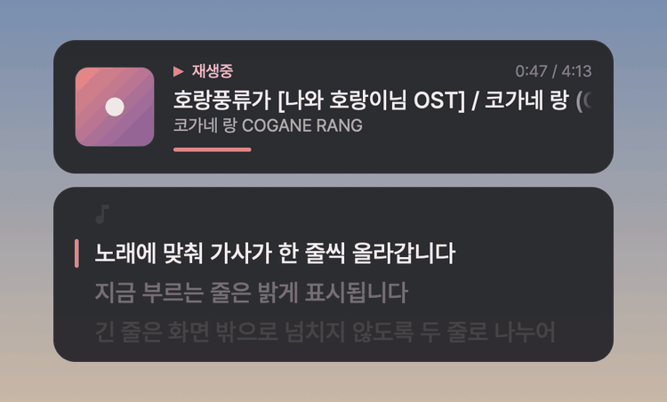
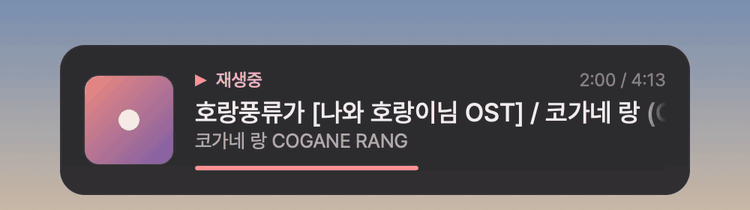

# Pear Now Playing

[Pear Desktop](https://github.com/pear-devs/pear-desktop)(YouTube Music 데스크톱 앱)에서 재생 중인 곡을 화면 위에 띄워주는 Windows 오버레이 위젯이에요.
곡이 바뀌면 화면 구석에 앨범 아트, 제목, 아티스트, 진행 바가 몇 초 동안 뜨고,
싱크 가사가 있는 곡은 YouTube Music 모바일 앱처럼 부드럽게 스크롤되는 가사 카드가 함께 떠요.

  

- 전체 화면 게임, 영상, 작업 화면 어디 위에든 떠요. 테두리 없는 창 모드 게임에서 쓰기 좋아요.
- 클릭과 키 입력은 아래 창으로 그대로 전달돼요. 위젯이 포커스를 가져가지 않아요.
- 전역 단축키로 이전 곡, 다음 곡, 재생/일시정지를 할 수 있어요.
- Windows 10/11에 기본으로 들어 있는 .NET Framework 4.8로 돌아가서 따로 설치할 게 없어요.

디자인은 [carol-web](https://github.com/team-carol/carol-web)의 디자인 시스템(색 토큰, Pretendard 계열 폰트, 16px 둥근 카드, 1px 테두리, 3px 강조선)을 따랐어요.

## 기능

| | |
|---|---|
| **곡 카드** | 앨범 아트, 제목, 아티스트·앨범, 진행 바. 곡이 바뀌거나 일시정지/재생할 때 잠깐 떴다가 사라져요. 계속 띄워둘 수도 있어요 |
| **싱크 가사** | [LRCLIB](https://lrclib.net)에서 타이밍 있는 가사를 찾아 곡 카드 아래에 붙여 보여줘요 |
| **긴 제목 스크롤** | 제목이 카드보다 길면 전광판처럼 옆으로 흘러가요 |
| **일본어 폰트** | 한국어·영어·일본어를 Pretendard JP 한 가지 폰트로 보여줘요 |
| **단축키** | 다시 보기, 재생/일시정지, 다음/이전 곡, 계속 표시, 가사 켜기/끄기 |

  

---

## 설치

### 1. Pear Desktop 설정 (처음 한 번)

1. Pear Desktop 메뉴에서 **플러그인 → API 서버 [베타]** 를 켜요.
2. (권장) 같은 메뉴의 **호스트 명**을 `0.0.0.0`에서 `127.0.0.1`로 바꿔요.
   `0.0.0.0`이면 같은 네트워크의 다른 기기에서도 API 서버에 접속을 시도할 수 있어요.
3. **포트**는 기본값 `26538` 그대로 두면 돼요. 바꿨다면 위젯 설정 파일의 `port`도 똑같이 맞춰요.
4. **인증 정책**은 기본값(첫 번째 요청 시 인증) 그대로 두면 돼요.

### 2. 실행

1. [Releases](../../releases)에서 zip을 받아 압축을 풀고 `PearNowPlaying.exe`를 실행해요.
   작업 표시줄 오른쪽 트레이에 음표 아이콘이 생겨요.
2. Pear Desktop에 **"pear-now-playing ... API에 액세스하도록 허용하시겠습니까?"** 창이 뜨면 **허용**을 눌러요. 처음 한 번만 물어봐요.
3. 노래를 틀면 화면 왼쪽 아래에 곡 정보가 떠요.

> 서명되지 않은 프로그램이라 처음 실행할 때 "Windows의 PC 보호" 창이 뜰 수 있어요. **추가 정보 → 실행**을 누르면 돼요.

Windows를 켤 때 자동으로 실행하려면 `Win + R` → `shell:startup` 폴더에 exe 바로가기를 넣으면 돼요.

## 단축키

| 단축키 | 기능 |
|---|---|
| `Ctrl + Alt + ↑` | 지금 곡 다시 보기 |
| `Ctrl + Alt + ↓` | 재생 / 일시정지 |
| `Ctrl + Alt + →` | 다음 곡 |
| `Ctrl + Alt + ←` | 이전 곡 |
| `Ctrl + Alt + P` | 곡 정보 계속 표시 켜기/끄기 |
| `Ctrl + Alt + L` | 가사 표시 켜기/끄기 |

다른 앱을 쓰는 중에도 동작해요. 다른 키로 바꾸고 싶으면 설정 파일에서 고치면 돼요.

## 가사

- 곡이 바뀌면 [LRCLIB](https://lrclib.net)(Pear Desktop의 가사 플러그인도 쓰는 공개 가사 DB)에서 싱크 가사를 찾아요. 매칭 방식도 Pear와 같아요.
- 찾으면 **곡 카드 바로 아래**에 가사 카드가 붙어서 계속 표시돼요. 두 카드는 너비가 같아서 한 덩어리처럼 보여요.
- 이전 줄·지금 줄·다음 줄이 한 목록으로 보이고, 줄이 바뀌면 목록이 부드럽게 위로 스크롤돼요.
  지금 줄은 밝게, 나머지는 흐리게 보이고, 위아래 끝으로 갈수록 자연스럽게 사라져요. 긴 줄은 두 줄까지 넘어가요.
- 곡 카드가 나타나거나 사라지면 가사 카드도 미끄러지듯 자리를 옮겨요.
- 간주 구간에는 ♪가 떠요. 일시정지하면 강조선이 회색으로 바뀌어요.
- 싱크 가사가 없는 곡(가사 DB에 없거나 타이밍 없는 가사만 있는 곡)은 가사 카드를 띄우지 않아요. 트레이 메뉴 맨 위에서 가사 상태를 볼 수 있어요.
- 가사가 노래보다 빠르거나 늦으면 트레이 메뉴의 **가사 타이밍**에서 맞추면 돼요.

> 영상 자막(YouTube 자막)을 가져오는 기능은 넣지 않았어요. 공식 방법 없이 YouTube 내부 데이터를 긁어와야 해서 YouTube 약관에 어긋나요.

## 긴 곡 제목

제목이 카드 너비보다 길면 1.8초 동안 앞부분을 보여준 뒤 옆으로 천천히 흘러가요.
끝까지 가면 제목 앞부분이 이어서 들어오면서 계속 반복되고, 양쪽 끝은 부드럽게 흐려져요.
제목이 카드에 다 들어가면 움직이지 않아요. 아티스트·앨범 줄은 `…`로 줄여서 보여줘요.

## 폰트

한국어, 영어, 일본어(가나와 상용 한자 약 7,100자) 모두 **Pretendard JP** 한 가지 폰트로 보여줘요.
폰트에 없는 글자(희귀 한자, 중국어 간체 등)가 섞인 줄만 Windows 폰트(Yu Gothic, 맑은 고딕)로 바뀌어요.

## 트레이 메뉴

트레이 아이콘을 우클릭하면 나와요. 아이콘을 더블클릭하면 지금 곡이 떠요.

- **곡 정보 계속 표시**: 곡 카드가 사라지지 않고 계속 떠 있게 해요. 진행 바가 실시간으로 움직여요.
- **가사 표시 / 가사 타이밍**: 가사 카드 켜기/끄기, 1초 빠르게 ~ 1초 늦게
- **위치**: 6곳 중에서 골라요. 기본은 왼쪽 아래예요.
- **크기**: 작게 / 보통 / 크게 / 아주 크게
- **이전 곡 / 재생·일시정지 / 다음 곡**
- **Pear 연결 권한 다시 요청**: 허용 창에서 실수로 거부했을 때 눌러요.
- **설정 파일 열기 / 설정 다시 불러오기 / 오류 기록 열기**

## 설정 파일

`%AppData%\PearNowPlaying\config.ini` 에 있어요. 트레이 메뉴의 **설정 파일 열기**로 바로 열 수 있고,
고친 뒤 **설정 다시 불러오기**를 누르면 적용돼요.

| 항목 | 기본값 | 설명 |
|---|---|---|
| `host`, `port` | `127.0.0.1`, `26538` | Pear Desktop API 서버 주소 |
| `position` | `BottomLeft` | `TopLeft`, `TopCenter`, `TopRight`, `BottomLeft`, `BottomCenter`, `BottomRight` |
| `marginX`, `marginY` | `40`, `140` | 화면 가장자리로부터의 여백(px). 다른 UI와 겹치면 조절해요 |
| `scale` | `1.0` | 크기 배율 |
| `panelWidth` | `420` | 곡 카드와 가사 카드의 너비(px) |
| `monitor` | `0` | 표시할 모니터 번호 (0 = 주 모니터) |
| `showSeconds` | `6` | 곡이 바뀌었을 때 표시하는 시간(초) |
| `opacity` | `0.92` | 배경 불투명도 |
| `alwaysShow` | `false` | 계속 표시 |
| `showOnPause` | `true` | 일시정지/재생할 때도 잠깐 표시 |
| `showAlbumArt` | `true` | 앨범 아트 표시 |
| `showLyrics` | `true` | 가사 카드 표시 |
| `lyricsOffsetMs` | `300` | 가사 타이밍 보정(ms). +면 빨리, -면 늦게 |
| `lyricsServer` | `https://lrclib.net` | 가사 DB 주소 |
| `hotkey...` | 위 표 참고 | 비워두면 그 단축키는 꺼져요 |

## 문제 해결

- **게임 위에 안 보여요**: 독점 전체 화면 모드는 다른 창이 위에 못 뜨게 하는 경우가 있어요.
  게임 설정에서 **테두리 없는 창 모드**(borderless / 전체 창 모드)로 바꿔보세요.
- **트레이 상태가 "Pear Desktop 기다리는 중"이에요**: Pear Desktop이 꺼져 있거나 API 서버 플러그인이 꺼져 있어요.
  포트를 바꿨다면 설정 파일의 `port`도 맞춰주세요.
- **"단축키를 등록하지 못했어요" 알림이 떠요**: 다른 프로그램이 같은 단축키를 쓰고 있어요. 설정 파일에서 다른 키로 바꿔주세요.
- **가사가 안 떠요**: 트레이 메뉴 맨 위 가사 상태를 보세요. '찾지 못함'이면 LRCLIB에 그 곡의 싱크 가사가 없는 거예요.
  YouTube Music의 곡 제목·아티스트가 가사 DB와 너무 다르면 못 찾을 수 있어요.
- **그 밖의 문제**: 트레이 메뉴 **오류 기록 열기**로 `error.log`를 확인해 주세요.

## 통신하는 곳

- 내 컴퓨터의 Pear Desktop API 서버(`127.0.0.1:26538`)
- 앨범 아트 이미지 주소 (YouTube Music이 쓰는 Google 이미지 서버)
- 가사 검색: `lrclib.net` (곡 제목, 아티스트, 앨범 이름만 보내요)

그 밖에는 인터넷에 접속하지 않아요. 연결 토큰은 `%AppData%\PearNowPlaying\token.txt`에 저장돼요.

## 빌드

C# 7.3, .NET Framework 4.8, WinForms로 만들었어요. 외부 패키지는 쓰지 않아요.

| 파일 | 내용 |
|---|---|
| `src/PearClient.cs` | Pear API 서버 인증(`POST /auth/{id}`), WebSocket(`/api/v1/ws`) 수신, 재생 제어 |
| `src/OverlayWindow.cs` | 클릭이 통과하는 항상 위 창 (`UpdateLayeredWindow`), 페이드와 이동 애니메이션 |
| `src/CardRenderer.cs` | 곡 카드 그리기, 긴 제목 스크롤 |
| `src/LyricsView.cs` | 스크롤되는 가사 목록과 전환 애니메이션 |
| `src/Lyrics.cs` | LRCLIB 검색(Pear와 같은 매칭 방식), LRC 파서 |
| `src/Theme.cs` | carol-web 색 토큰, Pretendard JP 로딩과 글리프 커버리지 확인 |
| `src/TrayApp.cs`, `src/Hotkeys.cs`, `src/Config.cs` | 트레이 메뉴, 전역 단축키, 설정 |

- **Windows**: [.NET SDK](https://dotnet.microsoft.com/download)를 깔고 `dotnet build -c Release` 하면 돼요. Visual Studio에서 `PearNowPlaying.csproj`를 열어도 돼요.
- **Linux**: `build.sh`가 dotnet SDK의 Roslyn 컴파일러와 Mono의 .NET Framework 참조 어셈블리로 `bin/PearNowPlaying.exe`를 만들어요.

## 라이선스 참고

Pretendard JP 폰트(Regular, Medium)를 exe 안에 포함했어요. SIL Open Font License 1.1로 배포되는 폰트이고,
라이선스 전문은 [`assets/fonts/PretendardJP-OFL.txt`](assets/fonts/PretendardJP-OFL.txt)에 있어요.
Copyright (c) 2021, Kil Hyung-jin (https://github.com/orioncactus/pretendard), with Reserved Font Name Pretendard JP.

YouTube Music, Pear Desktop과는 관계없는 개인 프로젝트예요.
