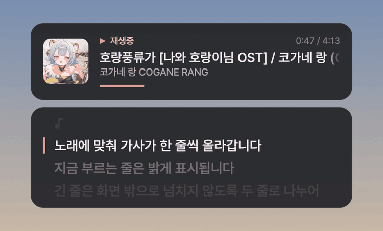
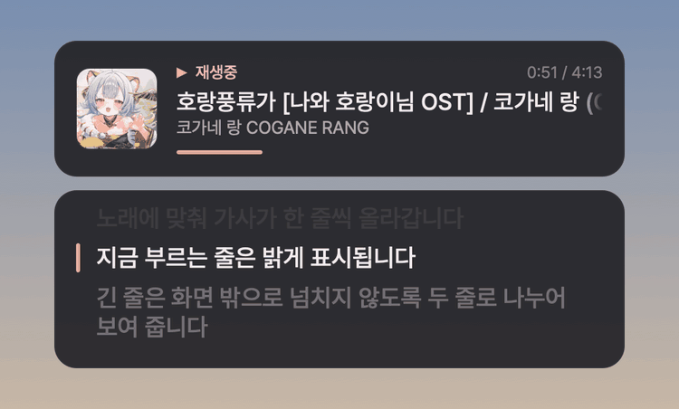
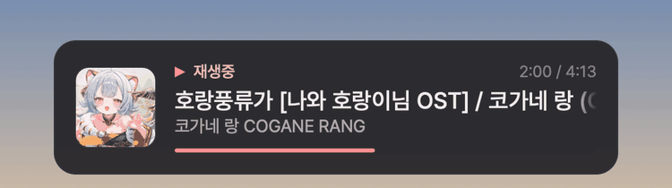

<h1 align="center">Now Playing Widget</h1>

  <b>English</b> · <a href="README.ko.md">한국어</a> · <a href="README.ja.md">日本語</a>

  A YouTube Music overlay that shows synced lyrics on top of any screen, 
  <b>including the original song's lyrics when you are listening to a cover.</b>

  
  
  

  

Now Playing Widget puts the song you are playing on YouTube Music in a corner of your screen: album art, title, artist, a progress bar, and a lyrics card that scrolls in time with the music. It works with YouTube Music in a **web browser** (Chrome, Edge, Safari and others) and with [Pear Desktop](https://github.com/pear-devs/pear-desktop) (the YouTube Music desktop app), on Windows 10/11 and macOS 13 or later.

- **Lyrics for covers.** For a cover (歌ってみた and similar), the widget works out which song is being covered and shows the original's synced lyrics. See [Lyrics for cover songs](#lyrics-for-cover-songs).
- **No browser extension.** Start the app, play YouTube Music in your browser, and the song appears.
- **On top of anything.** It stays above full-screen games, videos and whatever you are working in. Clicks and key presses pass through to the window underneath.
- **Global hotkeys** for previous song, next song and play/pause.
- **Nothing else to install.** The Windows version runs on .NET Framework 4.8, which ships with Windows.
- **Updates itself when you ask.** The app tells you when a new version is out and installs it from the menu.

> [!NOTE]
> The app's menus and status messages are in Korean only for now. This page gives each Korean label next to its English meaning so you can find it in the menu.

[Lyrics for cover songs](#lyrics-for-cover-songs) · [Install](#install) · [Features](#features) · [Menu](#menu) · [Updates](#updates) · [Config file](#config-file) · [Troubleshooting](#troubleshooting) · [How it works](#how-it-works) · [Network access](#network-access)

## Lyrics for cover songs

Lyrics databases are indexed by the original recording, so a cover uploaded as an ordinary video usually has no lyrics at all. Now Playing Widget finds the song being covered and shows **the original's synced lyrics** instead. Utaite covers (歌ってみた) usually sing over the original backing track, so the timing lines up well.

| What is playing | What the widget shows |
|---|---|
| An album track (official audio) | That track's synced lyrics |
| A music video | The lyrics of the same artist's official audio |
| A cover (歌ってみた and similar) | The **original song's** synced lyrics |
| A remix, arrangement, acoustic or short version | The original's lyrics are not borrowed, because the timing would not match |

### How the original is found

1. **Links in the video description.** Links labelled 原曲, 本家, original or 원곡 are checked first. Links to a Mix, an off-vocal track or the illustration are skipped.
2. **YouTube search.** If the description has no usable link, the widget searches YouTube for the song name and looks for the original on an official artist channel or a "- Topic" channel. If different songs share the name and it cannot settle on one, it picks none.
3. **Title and description text.** If there is still no match, it reads the song name and the original artist from the title and description and looks them up on LRCLIB. For example, `ワールドイズマイン / ryo(covered by …)` gives "ワールドイズマイン" and "ryo".

### When it shows nothing on purpose

Wrong lyrics are worse than no lyrics. The original's lyrics are not used when:

- the title contains words such as remix, arrange, アレンジ, 편곡, acoustic, 弾き語り, piano ver or short ver, or
- the video is more than 10 seconds longer or shorter than the original.

### Fixing the timing of one cover

If a cover's backing track is slightly off from the original, open **Lyrics → This song's lyric timing** (`가사 → 이 곡 가사 타이밍`) and adjust it in 0.1-second steps. The offset is remembered per video, so you only set it once.

### Good to know

- The lyrics status at the top of the menu shows where the lyrics came from, for example `(YouTube Music · 원곡)` (the original, from YouTube Music) or `(LRCLIB · 원곡 검색)` (the original, found by search on LRCLIB).
- The feature is marked beta and is on by default. To look up lyrics for album tracks only, turn off **Lyrics → Show lyrics for covers (beta)** (`가사 → 커버곡 가사 표시(beta)`).

## Install

### Windows

1. Download the zip whose name starts with `NowPlayingWidget-Windows` from [Releases](https://github.com/Roena0516/now-playing-widget/releases/latest) and extract it.
2. Run `NowPlayingWidget.exe`. A note icon appears in the tray at the right end of the taskbar.
3. Play YouTube Music (`music.youtube.com`) in your browser. The song appears at the bottom left of the screen.

> The app is not code-signed, so Windows may show "Windows protected your PC" the first time. Click **More info → Run anyway**.
> To start it with Windows, press `Win + R`, open `shell:startup`, and put a shortcut to the exe in that folder.

### macOS

1. Download the DMG whose name starts with `NowPlayingWidget-macOS` from [Releases](https://github.com/Roena0516/now-playing-widget/releases/latest) and open it.
2. Drag `Now Playing Widget.app` into `Applications` and run it. A note icon appears in the menu bar.
3. Play YouTube Music in your browser. The first time, macOS asks whether "Now Playing Widget" may control your browser (for example "Google Chrome"). Click **Allow** (or **OK**). The question appears once per browser and may open on another display.

> The app is not notarized by Apple, so it may not open the first time. Go to **System Settings → Privacy & Security** and click **Open Anyway**. Build instructions and details are in the [macOS guide](macos/README.md) (Korean).

### If you also use Pear Desktop

You only do this once.

1. In Pear Desktop, turn on **Plugins → API Server [Beta]**. Changing **Hostname** to `127.0.0.1` is recommended (with `0.0.0.0`, other devices on the same network can try to connect). Leave **Port** (`26538`) and **Authorization strategy** at their defaults.
2. In the widget's menu, click **Request Pear Desktop connection** (`Pear Desktop 연결 요청`).
3. When Pear Desktop asks "Allow pear-now-playing ... to access the API?", click **Allow**. From then on the widget connects automatically when it starts.

The widget does not ask Pear Desktop for a connection until you click the menu item in step 2. If you already connected on version 1.9.4 or earlier, you do not need to click it again.

## Features

### Song card

Shows the album art, the title, the artist and album, and a progress bar. It appears for a few seconds when the song or the playback state changes, or stays on screen with **Always show song info** (`곡 정보 계속 표시`, on by default). When playback is paused the card turns gray.

  

### Synced lyrics

- YouTube Music's own lyrics are tried first, then [LRCLIB](https://lrclib.net), then Kugou and NetEase (网易云音乐).
- Covers get **the original song's lyrics**, as described in [Lyrics for cover songs](#lyrics-for-cover-songs).
- While a song plays, the next song's lyrics are looked up in advance, so they appear as soon as the next song starts.
- The line being sung is highlighted, and the list scrolls up smoothly as lines change. Long lines are split over two rows.
- If lyrics run early or late, adjust them in 0.1-second steps with **This song's lyric timing** (`이 곡 가사 타이밍`, this video only) or **All songs' lyric timing** (`모든 곡 가사 타이밍`).

The exact order and rules are in [How it works](#how-it-works).

### Long titles

A title wider than the card scrolls sideways like a ticker. The beginning is shown for the first 1.8 seconds, and when the end has passed, the beginning follows it back in.

  

### Browser and Pear Desktop

Choose where songs come from under **Player** (`재생 앱`).

| Player | Behavior |
|---|---|
| **Auto (browser, Pear Desktop)** (`자동 (브라우저, Pear Desktop)`, default) | Watches both and shows the song from whichever started playing most recently. |
| **Browser** (`브라우저`) | Shows only YouTube Music in the browser. |
| **Pear Desktop** | Shows only Pear Desktop (the behavior up to 1.9.4). |

Supported browsers are Chrome, Edge, Brave, Whale, Vivaldi, Opera and Firefox on Windows, and Chrome, Edge, Brave, Arc, Whale, Vivaldi, Opera, Safari and Firefox on macOS. In a browser, the next song of a shuffled queue or a radio cannot be known in advance, so its lyrics are looked up when it starts.

### Discord status

Turn on **Discord → Show "Listening to"** (`Discord → 듣는 중 표시`) to show the song on your Discord profile. It is off at first.

- Shows the title, artist, album art and progress bar. Clicking the title or the album art opens the song on YouTube Music.
- Adds a **Now Playing Widget** button that links to this GitHub page. Turn it off with **Show GitHub button** (`GitHub 버튼 표시`).
- Works for songs from both the browser and Pear Desktop, and clears the status when you pause.
- The Discord **desktop app** has to be running. Discord in a browser cannot show it.

### Position, size and multiple monitors

- Pick one of six positions on the screen, or use **Drag the widget** (`위젯 끌어서 옮기기`) to put it anywhere.
- Four sizes, and transparency (text included) of none, 20%, 40% or 60%.
- The widget can be shown on several monitors at once, each with its own position, size and transparency.
- Korean, English and Japanese are all drawn with one font, **Pretendard JP**.

### Hotkeys

| Hotkey | Action |
|---|---|
| `Ctrl + Alt + ↑` | Show the current song again |
| `Ctrl + Alt + ↓` | Play / pause |
| `Ctrl + Alt + →` | Next song |
| `Ctrl + Alt + ←` | Previous song |
| `Ctrl + Alt + P` | Toggle "Always show song info" |
| `Ctrl + Alt + L` | Toggle lyrics |

They work while another app has focus. On macOS, `Ctrl` is Control and `Alt` is Option. Other key combinations can be set in the config file.

## Menu

Right-click the tray icon to open the menu (on macOS, click the menu bar icon). On Windows, double-clicking the icon shows the current song.

| Item | Korean label | What it does |
|---|---|---|
| App name and version, **Check for updates** button | `업데이트 확인` | At the top. The button checks without closing the menu and shows the result (`최신 버전`, up to date). If there is a new version it changes to `(version) 설치` (install), and clicking it installs. |
| Status line | | Shows what the widget is connected to (for example `브라우저 YouTube Music에 연결됨 (Chrome)`, connected to YouTube Music in Chrome) and the lyrics status. |
| **Show current song**, **Previous / Play·Pause / Next** | `지금 곡 보기`, `이전 곡 / 재생·일시정지 / 다음 곡` | Shows the current song again, or controls playback. |
| **Widget** | `위젯` | Always show song info (`곡 정보 계속 표시`), title for videos (`영상 곡 제목`: song title or video title), monitors to show on (`표시할 모니터`), position (`위치`), size (`크기`), transparency (`투명도`), Liquid Glass background (`Liquid Glass 배경(beta)`, macOS 26 or later only), drag the widget (`위젯 끌어서 옮기기`) |
| **Lyrics** | `가사` | Show lyrics (`가사 표시`), show lyrics for covers (`커버곡 가사 표시(beta)`), find lyrics again (`가사 다시 찾기`: deletes the saved lyrics and searches again), this song's lyric timing (`이 곡 가사 타이밍`), all songs' lyric timing (`모든 곡 가사 타이밍`) |
| **Player** | `재생 앱` | Auto, Browser or Pear Desktop. |
| **Discord** | `Discord` | Show "Listening to" (`듣는 중 표시`), show GitHub button (`GitHub 버튼 표시`) |
| **Request Pear Desktop connection** | `Pear Desktop 연결 요청` | Asks Pear Desktop for a connection. Hidden when the player is **Browser**. |
| **Open config file / Reload config / Open error log** | `설정 파일 열기 / 설정 다시 불러오기 / 오류 기록 열기` | Opens the config file or `error.log`. |

## Updates

- The app checks for a new version 30 seconds after it starts and once a day after that. If there is one, a notice appears on screen for a moment.
- It installs only when you click the `(version) 설치` button at the top of the menu. The app never restarts by itself in the middle of a game.
- The downloaded file is checked against the SHA-256 value and version reported by GitHub before it is installed. Because the app downloaded the file itself, the "Windows protected your PC" window and the macOS "Open Anyway" step are not needed again.
- **Coming from Pear Now Playing (1.9.4 or earlier)**: the old version's install-update button updates straight to this one, and your settings, Pear connection permission and saved lyrics carry over. On Windows the exe keeps its file name (`PearNowPlaying.exe`) so shortcuts do not break. On macOS the app is installed under the new name, `Now Playing Widget.app`.

## Config file

The config file is `%AppData%\PearNowPlaying\config.ini` (on macOS, `~/Library/Application Support/PearNowPlaying-macOS/config.json`). The folder keeps the app's previous name. Open it with **Open config file** (`설정 파일 열기`), edit it, then click **Reload config** (`설정 다시 불러오기`).

Per-video lyric timing (**This song's lyric timing**) is stored in `lyrics-timing.json` in the same folder as a video ID and an offset in milliseconds, which is added to `lyricsOffsetMs`. Videos you reset to the default are removed from the file, and beyond 5,000 entries the ones changed longest ago are removed first.

All config keys

| Key | Default | Description |
|---|---|---|
| `source` | `auto` | Where songs come from: `auto` (whichever of the browser and Pear Desktop started playing most recently), `browser` or `pear`. |
| `host`, `port` | `127.0.0.1`, `26538` | Address of the Pear Desktop API server. |
| `widget1`, `widget2`, … | `widget1=BottomLeft` | The monitor and position of each widget. The number matches "모니터 1", "모니터 2" (monitor 1, monitor 2) in the menu. The value is one of `TopLeft`, `TopCenter`, `TopRight`, `BottomLeft`, `BottomCenter`, `BottomRight`, or `Custom x y bottom` (a dragged position: x px from the monitor's left edge and y px from its bottom (`bottom`) or top (`top`) edge). |
| `widget1Show` … | `true` | Whether the widget is shown. With `false` it is hidden and only its settings are kept. |
| `widget1Scale`, `widget1Transparency`, … | `1.0`, `0` | Per-widget size multiplier and transparency (0 = opaque, 0.8 at most). Transparency also applies to the text. |
| `marginX`, `marginY` | `40`, `140` | Margin from the screen edge, in px. |
| `scale` | `1.0` | Size multiplier for widgets without a `widgetNScale`. |
| `panelWidth` | `420` | Width of the song card and the lyrics card, in px. |
| `showSeconds` | `6` | How long the song card is shown when the song changes, in seconds. |
| `opacity` | `0.92` | Opacity of the card background. The text is not affected. |
| `alwaysShow` | `true` | Whether the song card stays on screen. |
| `showOnPause` | `true` | Whether the song card is shown briefly on pause and resume. |
| `showAlbumArt` | `true` | Whether the album art is shown. |
| `videoTitle` | `false` | With `true`, videos that are not album tracks show the video title. With `false`, they show the song title. |
| `discordPresence` | `false` | Whether the song is shown on Discord as "Listening to". |
| `discordButton` | `true` | Whether the Discord status has a button that links to this GitHub page. |
| `showLyrics` | `true` | Whether the lyrics card is shown. |
| `coverLyrics` | `true` | The menu's "커버곡 가사 표시(beta)" (show lyrics for covers). With `false`, lyrics are looked up only for album tracks (official audio), and not for covers, music videos or ordinary uploads. `lyricsAlbumOnly=true` from 2.0.2 and earlier carries over as `coverLyrics=false`. |
| `checkUpdates` | `true` | Checks for a new version at startup and once a day. |
| `lyricsOffsetMs` | `300` | Lyric timing offset for all songs, in ms. Positive shows lyrics earlier, negative later. Change it with **All songs' lyric timing** in the menu, which displays the difference from the default (300). |
| `lyricsServer` | `https://lrclib.net` | Address of the LRCLIB server. |
| `ytmLyrics` | `true` | Whether YouTube Music's lyrics are tried first. Not in the menu. |
| `ytmLyricsProxy` | `https://ytmbrowseproxy.zvz.be/` | Address of the YouTube Music lyrics relay server. |
| `moreLyrics` | `true` | Whether Kugou and NetEase are also searched when LRCLIB has no synced lyrics. Not in the menu. |
| `hotkey...` | See the hotkey table above | An empty value disables that hotkey. |

## Troubleshooting

- **Nothing appears when I play in the browser**: Check that you are playing `music.youtube.com` and that the tab or player is **not muted**. A browser does not report playback from a muted tab to the operating system. Windows has to be 10 version 1809 or later. If another app (such as Spotify) started playing afterwards, press play in the browser again.
- **On macOS the song is sometimes matched to a different video**: In **System Settings → Privacy & Security → Automation**, check that your browser is turned on under Now Playing Widget.
- **The widget does not show over a game**: Exclusive full-screen mode can cover other windows. Try switching the game to **borderless windowed** mode.
- **The status says `Pear Desktop 연결 안 됨` (not connected) or `Pear Desktop 기다리는 중` (waiting)**: Check that Pear Desktop's API Server plugin is on, then click **Request Pear Desktop connection** (`Pear Desktop 연결 요청`). If you changed the port, set `port` in the config file to the same value.
- **A notice says `단축키를 등록하지 못했습니다` (could not register a hotkey)**: Another program is using the same hotkey. Change it to a different combination in the config file.
- **No lyrics appear**: Check the lyrics status at the top of the menu.
  - `찾지 못함` (not found): the lyrics databases have no synced lyrics for the song, or its length or other details differ too much from what is registered. Music video versions often differ in length from the official audio and are not found.
  - `가사 서버에 연결하지 못함` (could not reach the lyrics server): the lyrics server is not responding at the moment. Try **Find lyrics again** (`가사 다시 찾기`) a little later.
- **Anything else**: Open `error.log` with **Open error log** (`오류 기록 열기`). It records how the lyrics for each song were searched and why a search failed.

## How it works

How the song in the browser is identified

- The title, artist, position and playback state come from the media information the browser reports to the operating system (the same information as the media flyout that appears when you press a volume key on Windows, or "Now Playing" on macOS). Playback from other apps and other sites (YouTube, Netflix and so on) is not shown.
- The exact song (video ID) is read from the YouTube Music tab. On macOS, the automation permission is used to read only the address of the `music.youtube.com` tab, and the addresses of other tabs never leave the browser. On Windows, the address bar is read when the YouTube Music tab is at the front of its window, and the tab's name is read when it is behind another tab.
- When the address cannot be read (the tab is in the background on Windows, Firefox, or the automation permission was denied), the widget searches YouTube by title, artist and length. It accepts only a video on an official artist channel with a matching length. When unsure, it looks for lyrics by title and artist alone, without a video.
- **Position**: a browser reports the position only when playback starts, pauses or seeks, so the app adds elapsed time in between. If playback stalls briefly for buffering, lyrics can run slightly ahead until the next such event.
- **Next song**: a browser's queue cannot be read, so the next song is estimated from the order of the album or playlist the tab is playing. A list where the estimate was wrong once (shuffle, radio) is not looked up in advance until the estimate is right again.
- **Playback control**: play/pause, next and previous from the menu and the hotkeys are sent to the browser as operating system media commands.
- In auto mode, the song from whichever started playing most recently is shown, and when that one pauses the widget switches to the other if it is playing.

Where lyrics are looked up, in order

1. **YouTube Music**: the lyrics shown in the YouTube Music app, fetched the same way as Pear's YTMusic lyrics provider. For a music video, the widget finds the same artist's **official audio** and uses its lyrics.
2. **[LRCLIB](https://lrclib.net)**: this public lyrics database is used when YouTube Music has no lyrics or the request fails. Even when the artist is written differently (such as `Mikito-P` and `みきとP`), a result with the same title and a length within 3 seconds counts as the same song.
3. **Kugou, NetEase (网易云音乐)**: asked only when LRCLIB has no synced lyrics or answers with a rate limit (429). They have many songs LRCLIB lacks, such as Vocaloid, utaite and Korean songs. They also have many covers and remixes with the same title, so a result is used only when the title and artist match and the length is within 15 seconds (or, if the artist is written differently, the title matches exactly and the length is within 3 seconds). Neither is an official API and either may stop working. Turn them off with `moreLyrics=false` in the config file.

For **covers**, see [Lyrics for cover songs](#lyrics-for-cover-songs).

**Looking up the next song early**: the next song's lyrics are looked up 10 seconds after the current song starts. If that fails because the lyrics server is busy, it is tried again after 30 and 90 seconds, and a song that was not found is searched again when it actually starts.

> Fetching video captions (YouTube subtitles) is deliberately not included. Without an official method it would mean collecting YouTube's internal data, which is against YouTube's terms.

Lyrics cache and LRCLIB request rules

- Lyrics from LRCLIB, Kugou and NetEase are saved on your computer (`%LocalAppData%\PearNowPlaying\lyrics-cache`, or `~/Library/Caches/PearNowPlaying-macOS/lyrics` on macOS) and shown immediately the next time the song plays. Lyrics older than 90 days are looked up again, and beyond 3,000 songs the oldest are deleted first. If saved lyrics are wrong, click **Find lyrics again** (`가사 다시 찾기`).
- A song whose lyrics came from Kugou or NetEase may have been added to LRCLIB since, so LRCLIB is asked again when the song is replayed (once a day within the same run).
- The app follows the rules in LRCLIB's [API documentation](https://lrclib.net/docs). Requests are sent one at a time with at least 0.3 seconds between them, and no more than 60 per minute.
- When LRCLIB answers `502`, `503` or `504` (busy), the app waits for the time in the `Retry-After` header (1 second if absent) plus a random 0–30%, then asks again. It keeps trying for up to 10 minutes while the song is playing.
- When LRCLIB answers `429` (too many requests), lyrics from Kugou and NetEase are shown in the meantime, and LRCLIB is asked again later.
- After 3 failed requests in a row to the YouTube Music lyrics relay server, only LRCLIB is used for 10 minutes. **Find lyrics again** retries immediately.
- A search that failed because of a server error is not saved as "no lyrics", so the song is searched again the next time it plays.

Album track titles

YouTube Music shows song titles in the app's language, so an album track with a registered translated title may show only the translation instead of the original title (for example, `心を刺す言葉だけ` shown as `Only Words`). For such songs the widget checks YouTube Music's playlist information and shows the title as **original - translation** (`心を刺す言葉だけ - Only Words`). Right after the song starts the translated title may be visible for a moment. It usually changes within a second.

How updates are installed

- On Windows, the version of the new exe in the downloaded zip is checked, then the current exe is replaced and the app restarts. The previous exe is kept with `.old` added to its name and deleted on the next start. If the install fails (for example in a folder without write permission), the original exe is left as it is and the release page opens.
- On macOS, the downloaded DMG is opened without showing it on screen, the app's signature, bundle ID and version are checked, then the app is replaced and restarted. Without permission to replace the app, the DMG is opened so you can install it yourself. Details are under "업데이트" (updates) in the [macOS guide](macos/README.md) (Korean).
- To turn off the automatic check, set `checkUpdates` to `false` in the config file.

## Network access

| Where | When | What is exchanged |
|---|---|---|
| This computer | Always | The operating system's media information, the address and title of the browser's YouTube Music tab (other tabs are not read), the Pear Desktop API server (`127.0.0.1:26538`), and the Discord app (when "Listening to" is on) |
| Google image servers | When the song changes | The album art image. With the Discord status on, Discord fetches this image too. |
| `music.youtube.com` | When the song changes (`ytmLyrics=true`) | Sends the video ID and receives song information (title, artist, length, video type), a lyrics ID, and the order of the album or playlist. For a music video, the artist page is used to find the official audio. |
| `ytmbrowseproxy.zvz.be` | When looking up YouTube Music lyrics | Sends the lyrics ID and receives the lyrics. This is the **third-party relay server** used by Pear Desktop's YTMusic lyrics provider, not an official Google server. It is used because lyrics cannot be fetched from YouTube Music directly without signing in. |
| `www.youtube.com` | For a cover, or when the tab address could not be read | Reads the cover video's description, and searches by song name and artist to find the original or the song's video. |
| `lrclib.net` | When looking up lyrics | Sends the song title, artist, album name and length. |
| `lyrics.kugou.com`, `music.163.com` | When LRCLIB has no synced lyrics or answers with a rate limit (429) (`moreLyrics=true`) | Sends the song title, artist and length, and receives lyrics. These are unofficial routes used by each service's own app. |
| `api.github.com`, `github.com` | When checking for and installing updates | Receives the latest release information and the release file. Nothing but the app version is sent. |

The app does not connect anywhere else. It never sends Google account cookies or the Pear connection token to any server. The YouTube Music and relay server routes are not official APIs and may stop working, in which case only LRCLIB is used automatically. The Pear connection token is stored in `%AppData%\PearNowPlaying\token.txt`.

## Build

The Windows version is written in C# 7.3 on .NET Framework 4.8 with WinForms, and uses no external packages.

- **Windows**: install the [.NET SDK](https://dotnet.microsoft.com/download) and run `dotnet build -c Release`. You can also open `NowPlayingWidget.csproj` in Visual Studio and build it there.
- **Linux**: `build.sh` builds `bin/NowPlayingWidget.exe` with the Roslyn compiler from the dotnet SDK and Mono's .NET Framework reference assemblies.
- **macOS version**: see the [macOS guide](macos/README.md) (Korean).
- The GIFs in this README can be regenerated with `./macos/build.sh` followed by `python3 macos/Tools/make-gifs.py` (they are drawn by the app's own renderer).

Source files

| File | Contents |
|---|---|
| `src/BrowserSource.cs` | Browser integration: media controls (SMTC), reading browser windows and tabs (UI Automation), identifying the song in the YouTube Music tab |
| `src/PearClient.cs` | Choosing the song source (browser, Pear), Pear API server authentication (`POST /auth/{id}`), WebSocket (`/api/v1/ws`), playback control |
| `src/DiscordPresence.cs` | Discord "Listening to" status (local connection to the Discord app) |
| `src/OverlayWindow.cs` | Click-through always-on-top window (`UpdateLayeredWindow`), fade and move animations |
| `src/CardRenderer.cs` | Drawing the song card, scrolling long titles |
| `src/LyricsView.cs` | The scrolling lyrics list and its transition animations |
| `src/Lyrics.cs` | Lyrics lookup order, LRCLIB search (same matching as Pear), LRC parser |
| `src/MoreLyrics.cs` | Kugou and NetEase lyrics search, result matching, removing credit lines |
| `src/YtmLyrics.cs` | YouTube Music lyrics (same method as Pear's YTMusic lyrics provider), finding the official audio, reading video descriptions, YouTube search |
| `src/CoverLyrics.cs` | Picking the original's link from a cover's description, picking the original from search results, filtering out arrangements and remixes |
| `src/Theme.cs` | Color tokens, loading Pretendard JP and checking glyph coverage |
| `src/TrayApp.cs`, `src/Hotkeys.cs`, `src/Config.cs` | Tray menu, global hotkeys, settings |

## License notes

The app bundles the Pretendard JP font (Regular, Medium). The font is distributed under the SIL Open Font License 1.1, and the full license text is in [`assets/fonts/PretendardJP-OFL.txt`](assets/fonts/PretendardJP-OFL.txt).
Copyright (c) 2021, Kil Hyung-jin (https://github.com/orioncactus/pretendard), with Reserved Font Name Pretendard JP.

The example screens in this README use the title and thumbnail of 코가네 랑's cover video of 「호랑풍류가」. The lyric lines on screen are example sentences that describe the widget, not the actual lyrics.

This is a personal project and is not affiliated with YouTube Music or Pear Desktop. YouTube Music is a trademark of Google LLC.
