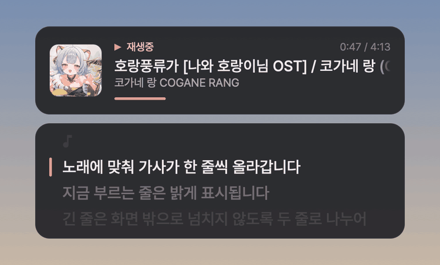
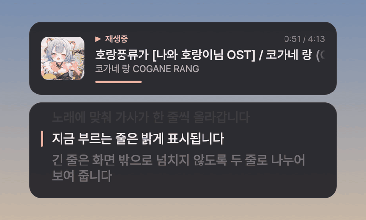
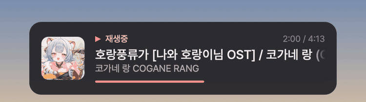

# Now Playing Widget

Now Playing Widget은 YouTube Music에서 재생 중인 곡을 화면 위에 표시하는 오버레이 위젯입니다. **웹 브라우저**(Chrome, Edge, Safari 등)에서 재생하는 YouTube Music과 [Pear Desktop](https://github.com/pear-devs/pear-desktop)(YouTube Music 데스크톱 앱)을 모두 지원합니다. Windows 10/11과 macOS 13 이상에서 사용할 수 있습니다.
곡이 재생 중이라면 화면 구석에 앨범 아트, 제목, 아티스트, 진행 바가 몇 초 동안 나타납니다.
가사가 있는 곡이라면 부드럽게 스크롤되는 가사 카드도 함께 표시합니다.

  

- 브라우저 확장 프로그램을 설치하지 않아도 됩니다. 앱을 실행한 뒤 브라우저에서 YouTube Music을 재생하면 바로 표시됩니다.
- 전체 화면 게임, 영상, 작업 중인 창 등 어떤 화면 위에도 표시됩니다. 클릭과 키 입력은 위젯 아래에 있는 창으로 그대로 전달됩니다.
- 전역 단축키로 이전 곡, 다음 곡, 재생/일시정지를 조작할 수 있습니다.
- 새 버전이 나오면 앱이 알려주고, 메뉴에서 누르면 직접 받아서 설치합니다.
- 따로 설치할 프로그램이 없습니다. Windows 버전은 Windows에 기본으로 들어 있는 .NET Framework 4.8에서 실행됩니다.

[설치](#설치) · [기능](#기능) · [메뉴](#메뉴) · [업데이트](#업데이트) · [설정 파일](#설정-파일) · [문제 해결](#문제-해결) · [자세한 동작](#자세한-동작) · [통신하는 곳](#통신하는-곳)

## 설치

### Windows

1. [Releases](../../releases)에서 `NowPlayingWidget-Windows`로 시작하는 zip 파일을 내려받아 압축을 풉니다.
2. `NowPlayingWidget.exe`를 실행합니다. 작업 표시줄 오른쪽 트레이에 음표 아이콘이 나타납니다.
3. 브라우저에서 YouTube Music(`music.youtube.com`)을 재생하면 화면 왼쪽 아래에 곡 정보가 나타납니다.

> 코드 서명이 되어 있지 않아서, 처음 실행할 때 "Windows의 PC 보호" 창이 나타날 수 있습니다. 그러면 **추가 정보 → 실행**을 누릅니다.
> Windows를 시작할 때 자동으로 실행하려면 `Win + R`로 `shell:startup` 폴더를 열고 exe 바로 가기를 넣습니다.

### macOS

1. [Releases](../../releases)에서 `NowPlayingWidget-macOS`로 시작하는 DMG 파일을 내려받아 엽니다.
2. `Now Playing Widget.app`을 `Applications` 폴더로 끌어다 놓고 실행합니다. 메뉴 막대에 음표 아이콘이 나타납니다.
3. 브라우저에서 YouTube Music을 재생합니다. 처음에는 **"Now Playing Widget"이(가) "Google Chrome"을(를) 제어하려고 합니다** 같은 창이 나타나므로 **허용**을 누릅니다. 이 창은 브라우저마다 한 번만 나타나며, 다른 화면에 뜰 수도 있습니다.

> Apple의 공증을 받지 않아서 처음 실행할 때 열리지 않을 수 있습니다. 그러면 **시스템 설정 → 개인정보 보호 및 보안**에서 **그래도 열기**를 누릅니다. 빌드 방법과 설정은 [macOS 안내](macos/README.md)에 있습니다.

### Pear Desktop을 함께 쓰는 경우

처음 한 번만 설정합니다.

1. Pear Desktop 메뉴에서 **플러그인 → API 서버 [베타]** 를 켭니다. **호스트 명**은 `127.0.0.1`로 바꾸는 것을 권장하고(`0.0.0.0`이면 같은 네트워크의 다른 기기도 접속을 시도할 수 있습니다), **포트**(`26538`)와 **인증 정책**은 기본값을 그대로 둡니다.
2. 위젯의 메뉴에서 **Pear Desktop 연결 요청**을 누릅니다.
3. Pear Desktop에 **"pear-now-playing ... API에 액세스하도록 허용하시겠습니까?"** 창이 나타나면 **허용**을 누릅니다. 그 뒤로는 위젯을 켤 때 자동으로 연결됩니다.

위젯은 2번을 누르기 전에는 Pear Desktop에 연결을 요청하지 않습니다. 1.9.4 이하에서 이미 연결해 둔 경우에는 다시 누를 필요가 없습니다.

## 기능

### 곡 카드

앨범 아트, 제목, 아티스트·앨범, 진행 바를 표시합니다. 곡이 바뀌거나 재생 상태가 바뀌면 잠시 나타났다가 사라지며, 메뉴의 **곡 정보 계속 표시**로 계속 띄워 둘 수 있습니다(기본값). 일시정지하면 표시가 회색으로 바뀝니다.

  

### 싱크 가사

- YouTube Music 가사를 먼저 찾고, 없으면 [LRCLIB](https://lrclib.net), 그다음 Kugou와 NetEase(网易云音乐)에서 찾습니다.
- 커버곡(歌ってみた 등)은 영상 설명란이나 YouTube 검색으로 원곡을 찾아 **원곡의 가사**를 표시합니다.
- 곡이 재생되는 동안 다음 곡의 가사를 미리 찾아 두므로, 다음 곡이 시작되면 가사가 바로 나타납니다.
- 지금 부르는 줄을 밝게 표시하고, 줄이 바뀌면 부드럽게 위로 스크롤합니다. 긴 줄은 두 줄로 나누어 보여 줍니다.
- 가사가 노래보다 빠르거나 늦으면 메뉴의 **가사 타이밍**에서 조정합니다.

자세한 순서와 규칙은 아래 [자세한 동작](#자세한-동작)에 있습니다.

### 긴 제목

제목이 카드보다 길면 전광판처럼 옆으로 흘러갑니다. 처음 1.8초는 앞부분을 보여 주고, 끝이 지나가면 앞부분이 다시 이어서 들어옵니다.

  

### 브라우저와 Pear Desktop

메뉴의 **재생 앱**에서 곡을 가져올 곳을 고릅니다.

| 재생 앱 | 동작 |
|---|---|
| **자동 (브라우저, Pear Desktop)** (기본값) | 둘 다 확인하고, 나중에 재생을 시작한 쪽의 곡을 표시합니다. |
| **브라우저** | 브라우저의 YouTube Music만 표시합니다. |
| **Pear Desktop** | Pear Desktop만 표시합니다(1.9.4까지와 같은 동작). |

지원하는 브라우저는 Chrome, Edge, Brave, Whale, Vivaldi, Opera, Firefox(Windows)와 Chrome, Edge, Brave, Arc, Whale, Vivaldi, Opera, Safari, Firefox(macOS)입니다. 브라우저에서 들을 때는 셔플이나 라디오의 다음 곡을 미리 알 수 없어서, 그때는 곡이 시작될 때 가사를 찾습니다.

### Discord 상태

메뉴의 **Discord → 듣는 중 표시**를 켜면, 듣는 곡을 Discord 프로필에 "듣는 중"으로 표시합니다. 처음에는 꺼져 있습니다.

- 곡 제목, 아티스트, 앨범 아트, 진행 바를 표시합니다. 제목이나 앨범 아트를 누르면 그 곡이 YouTube Music에서 열립니다.
- 이 앱의 GitHub 페이지로 가는 **Now Playing Widget** 버튼을 함께 표시합니다. **GitHub 버튼 표시**로 끌 수 있습니다.
- 브라우저와 Pear Desktop의 곡을 모두 표시하며, 일시정지하면 표시를 지웁니다.
- Discord **데스크톱 앱**이 실행 중이어야 합니다. 브라우저에서 여는 Discord(웹)에는 표시할 수 없습니다.

### 위치, 크기, 여러 모니터

- 위젯의 위치를 화면의 여섯 곳 중에서 고르거나, **위젯 끌어서 옮기기**로 원하는 곳에 놓습니다.
- 크기는 네 단계, 투명도(글자 포함)는 없음·20%·40%·60% 중에서 고릅니다.
- 여러 모니터에 위젯을 동시에 띄우고, 모니터마다 위치, 크기, 투명도를 다르게 정할 수 있습니다.
- 한국어, 영어, 일본어를 **Pretendard JP** 폰트 하나로 표시합니다.

### 단축키

| 단축키 | 기능 |
|---|---|
| `Ctrl + Alt + ↑` | 지금 곡 다시 보기 |
| `Ctrl + Alt + ↓` | 재생 / 일시정지 |
| `Ctrl + Alt + →` | 다음 곡 |
| `Ctrl + Alt + ←` | 이전 곡 |
| `Ctrl + Alt + P` | 곡 정보 계속 표시 켜기/끄기 |
| `Ctrl + Alt + L` | 가사 표시 켜기/끄기 |

다른 앱을 사용하는 중에도 동작합니다. macOS에서는 `Ctrl`이 Control, `Alt`가 Option 키입니다. 다른 키 조합은 설정 파일에서 바꿉니다.

## 메뉴

트레이 아이콘을 마우스 오른쪽 버튼으로 클릭하면 메뉴가 나타납니다(macOS는 메뉴 막대 아이콘을 클릭합니다). Windows에서는 아이콘을 더블클릭하면 지금 곡이 표시됩니다.

| 항목 | 설명 |
|---|---|
| **업데이트 확인 / 업데이트 설치** | 맨 위에 있습니다. 새 버전이 있으면 **업데이트 설치 (버전)**으로 바뀝니다. |
| 상태 줄 | 어디에 연결되어 있는지("브라우저 YouTube Music에 연결됨 (Chrome)" 등)와 가사 상태를 표시합니다. |
| **지금 곡 보기**, **이전 곡 / 재생·일시정지 / 다음 곡** | 지금 곡을 다시 보여 주거나 재생을 조작합니다. |
| **위젯** | 곡 정보 계속 표시, 영상 곡 제목(곡 제목 또는 영상 제목), 표시할 모니터, 위치, 크기, 투명도, 위젯 끌어서 옮기기 |
| **가사** | 가사 표시, 앨범 곡만 가사 표시, 가사 다시 찾기(저장된 가사를 지우고 새로 찾음), 가사 타이밍 |
| **재생 앱** | 자동, 브라우저, Pear Desktop 중에서 고릅니다. |
| **Discord** | 듣는 중 표시, GitHub 버튼 표시 |
| **Pear Desktop 연결 요청** | Pear Desktop에 연결을 요청합니다. 재생 앱이 **브라우저**이면 나타나지 않습니다. |
| **설정 파일 열기 / 설정 다시 불러오기 / 오류 기록 열기** | 설정 파일과 `error.log`를 엽니다. |

## 업데이트

- 앱을 켜고 30초 뒤와, 그 뒤 하루에 한 번 새 버전을 확인합니다. 새 버전이 있으면 화면에 안내가 잠시 나타납니다.
- 설치는 메뉴에서 **업데이트 설치**를 눌렀을 때만 합니다. 게임을 하는 중에 앱이 저절로 다시 시작되지 않습니다.
- 받은 파일은 GitHub가 알려 주는 SHA-256 값과 버전을 확인한 뒤 설치합니다. 앱이 직접 받은 파일이므로 "Windows의 PC 보호" 창이나 macOS의 "그래도 열기"는 다시 필요하지 않습니다.
- **Pear Now Playing(1.9.4 이하)에서 넘어올 때**: 이전 버전의 **업데이트 설치**로 그대로 업데이트되고, 설정, Pear 연결 권한, 저장된 가사도 이어집니다. Windows에서는 바로 가기가 끊어지지 않도록 exe 파일 이름(`PearNowPlaying.exe`)을 바꾸지 않습니다. macOS에서는 앱이 `Now Playing Widget.app`으로 이름을 바꿔서 설치됩니다.

## 설정 파일

설정 파일은 `%AppData%\PearNowPlaying\config.ini`(macOS는 `~/Library/Application Support/PearNowPlaying-macOS/config.json`)에 있습니다. 폴더 이름은 이전 이름을 그대로 씁니다. 메뉴의 **설정 파일 열기**로 열고, 수정한 뒤 **설정 다시 불러오기**를 누릅니다.

설정 항목 전체 보기

| 항목 | 기본값 | 설명 |
|---|---|---|
| `source` | `auto` | 곡을 가져올 곳입니다. `auto`(브라우저와 Pear Desktop 중 나중에 재생을 시작한 쪽), `browser`, `pear` 중 하나입니다. |
| `host`, `port` | `127.0.0.1`, `26538` | Pear Desktop API 서버의 주소입니다. |
| `widget1`, `widget2`, … | `widget1=BottomLeft` | 위젯을 띄울 모니터와 위치입니다. 숫자는 메뉴의 "모니터 1", "모니터 2"와 같은 번호이고, 값은 `TopLeft`, `TopCenter`, `TopRight`, `BottomLeft`, `BottomCenter`, `BottomRight` 중 하나이거나 `Custom x y bottom`(끌어서 옮겨 둔 위치: 모니터의 왼쪽 가장자리에서 x px, 아래쪽(`bottom`) 또는 위쪽(`top`) 가장자리에서 y px)입니다. |
| `widget1Show` … | `true` | 위젯을 표시할지 정합니다. `false`이면 표시하지 않고 그 위젯의 설정만 보관합니다. |
| `widget1Scale`, `widget1Transparency`, … | `1.0`, `0` | 위젯마다의 크기 배율과 투명도(0 = 불투명, 최대 0.8)입니다. 투명도는 글자까지 함께 투명하게 합니다. |
| `marginX`, `marginY` | `40`, `140` | 화면 가장자리로부터 떨어진 여백(px)입니다. |
| `scale` | `1.0` | 크기 배율입니다. `widgetNScale`이 없는 위젯에 적용됩니다. |
| `panelWidth` | `420` | 곡 카드와 가사 카드의 너비(px)입니다. |
| `showSeconds` | `6` | 곡이 바뀌었을 때 곡 카드를 표시하는 시간(초)입니다. |
| `opacity` | `0.92` | 카드 배경의 불투명도입니다. 글자는 그대로입니다. |
| `alwaysShow` | `true` | 곡 카드를 계속 표시할지 정합니다. |
| `showOnPause` | `true` | 일시정지하거나 다시 재생할 때도 곡 카드를 잠시 표시할지 정합니다. |
| `showAlbumArt` | `true` | 앨범 아트를 표시할지 정합니다. |
| `videoTitle` | `false` | `true`이면 앨범 곡이 아닌 영상에 영상 제목을, `false`이면 곡 제목을 표시합니다. |
| `discordPresence` | `false` | 듣는 곡을 Discord에 "듣는 중"으로 표시할지 정합니다. |
| `discordButton` | `true` | Discord 상태에 이 앱의 GitHub 페이지로 가는 버튼을 붙일지 정합니다. |
| `showLyrics` | `true` | 가사 카드를 표시할지 정합니다. |
| `lyricsAlbumOnly` | `false` | `true`이면 앨범 곡(공식 음원)에서만 가사를 찾아 표시합니다. |
| `checkUpdates` | `true` | 시작할 때와 하루에 한 번 새 버전이 있는지 확인합니다. |
| `lyricsOffsetMs` | `300` | 가사 타이밍 보정값(ms)입니다. 양수이면 가사가 더 빨리, 음수이면 더 늦게 표시됩니다. |
| `lyricsServer` | `https://lrclib.net` | LRCLIB 서버의 주소입니다. |
| `ytmLyrics` | `true` | YouTube Music 가사를 먼저 찾을지 정합니다. 메뉴에는 없는 설정입니다. |
| `ytmLyricsProxy` | `https://ytmbrowseproxy.zvz.be/` | YouTube Music 가사 중계 서버의 주소입니다. |
| `moreLyrics` | `true` | LRCLIB에 싱크 가사가 없을 때 Kugou와 NetEase에서도 찾을지 정합니다. 메뉴에는 없는 설정입니다. |
| `hotkey...` | 위 단축키 표 참고 | 값을 비워 두면 그 단축키를 사용하지 않습니다. |

## 문제 해결

- **브라우저에서 재생해도 곡이 나타나지 않습니다**: `music.youtube.com`을 재생하고 있는지, 탭이나 플레이어가 **음소거되어 있지 않은지** 확인합니다. 음소거된 탭은 브라우저가 운영체제에 재생 정보를 알리지 않습니다. Windows는 10 1809 이상이어야 합니다. 다른 앱(Spotify 등)이 나중에 재생을 시작했다면 브라우저에서 다시 재생합니다.
- **macOS에서 곡이 가끔 다른 영상으로 잡힙니다**: **시스템 설정 → 개인정보 보호 및 보안 → 자동화**에서 Now Playing Widget 아래의 브라우저가 켜져 있는지 확인합니다.
- **게임 위에 위젯이 보이지 않습니다**: 독점 전체 화면 모드는 다른 창을 가리는 경우가 있습니다. 게임의 화면 모드를 **테두리 없는 창 모드**로 바꿔 보시기 바랍니다.
- **상태가 "Pear Desktop 연결 안 됨"이나 "Pear Desktop 기다리는 중"으로 표시됩니다**: Pear Desktop의 API 서버 플러그인이 켜져 있는지 확인하고, 메뉴의 **Pear Desktop 연결 요청**을 누릅니다. 포트를 바꿨다면 설정 파일의 `port`도 같은 값으로 바꿉니다.
- **"단축키를 등록하지 못했습니다" 알림이 나타납니다**: 다른 프로그램이 같은 단축키를 사용하고 있습니다. 설정 파일에서 다른 키 조합으로 바꿔 주시기 바랍니다.
- **가사가 표시되지 않습니다**: 메뉴 맨 위의 가사 상태를 확인합니다.
  - '찾지 못함': 가사 데이터베이스에 그 곡의 싱크 가사가 없거나, 곡의 길이 등이 등록된 정보와 너무 다른 경우입니다. MV 버전은 공식 음원과 길이가 달라서 찾지 못하는 경우가 많습니다.
  - '가사 서버에 연결하지 못함': 가사 서버가 잠시 응답하지 않는 상태입니다. 잠시 뒤에 **가사 다시 찾기**를 눌러 주시기 바랍니다.
- **그 밖의 문제**: 메뉴의 **오류 기록 열기**로 `error.log`를 확인합니다. 곡마다 가사를 어떻게 찾았는지, 왜 찾지 못했는지가 기록됩니다.

## 자세한 동작

브라우저에서 곡을 알아내는 방법

- 브라우저가 운영체제에 알리는 미디어 정보(Windows에서 볼륨 키를 누르면 나타나는 미디어 창, macOS의 "지금 재생 중"과 같은 정보)에서 제목, 아티스트, 재생 위치, 재생 상태를 읽습니다. 다른 앱이나 다른 사이트(YouTube, Netflix 등)의 재생은 표시하지 않습니다.
- 정확한 곡(영상 ID)은 YouTube Music 탭에서 읽습니다. macOS는 자동화 권한으로 `music.youtube.com` 탭의 주소만 읽으며, 다른 탭의 주소는 브라우저 밖으로 나오지 않습니다. Windows는 YouTube Music 탭이 창의 맨 앞에 있으면 주소 표시줄을 읽고, 다른 탭 뒤에 있으면 탭 이름을 읽습니다.
- 주소를 읽지 못하면(Windows에서 탭이 뒤에 있을 때, Firefox, 자동화 권한을 거부했을 때) 제목, 아티스트, 길이로 YouTube를 검색해서 영상을 찾습니다. 공식 아티스트 채널이고 길이가 맞는 영상만 고르며, 확실하지 않으면 영상 없이 제목과 아티스트로만 가사를 찾습니다.
- **재생 위치**: 브라우저는 재생을 시작하거나, 일시정지하거나, 구간을 옮길 때만 위치를 알리므로 그 사이는 앱이 시간을 더해서 계산합니다. 재생이 버퍼링으로 잠깐 멈추면 가사가 조금 앞서다가 다음 조작 때 맞춰질 수 있습니다.
- **다음 곡**: 브라우저의 재생 대기열은 읽을 수 없으므로, 탭이 재생 중인 앨범이나 재생목록의 순서로 다음 곡을 추정합니다. 추정이 한 번 틀린 목록(셔플, 라디오)은 다시 맞을 때까지 미리 찾지 않습니다.
- **재생 제어**: 메뉴와 단축키의 재생/일시정지, 다음 곡, 이전 곡은 운영체제의 미디어 명령으로 브라우저에 보냅니다.
- 자동 모드에서는 나중에 재생을 시작한 쪽의 곡을 표시하고, 표시하던 쪽이 일시정지하면 재생 중인 다른 쪽으로 넘어갑니다.

가사를 찾는 순서와 커버곡

1. **YouTube Music**: YouTube Music 앱에 표시되는 가사입니다. Pear의 YTMusic 가사 제공자와 같은 방식으로 가져옵니다. MV를 재생하면 같은 아티스트의 **공식 음원**을 찾아 그 가사를 씁니다.
2. **[LRCLIB](https://lrclib.net)**: YouTube Music에서 찾지 못했거나 요청이 실패하면 이 공개 가사 데이터베이스에서 찾습니다. 아티스트 표기가 다르더라도(`Mikito-P`와 `みきとP`처럼) 제목이 같고 길이 차이가 3초 이내이면 같은 곡으로 봅니다.
3. **Kugou, NetEase(网易云音乐)**: LRCLIB에 싱크 가사가 없거나 LRCLIB가 요청 제한(429)으로 답할 때만 묻습니다. 보컬로이드, 우타이테, 한국 곡처럼 LRCLIB에 없는 곡이 많습니다. 같은 제목의 커버와 리믹스도 많아서, 제목과 아티스트가 같고 길이 차이가 15초 이내인 결과만 씁니다(아티스트 표기가 다르면 제목이 정확히 같고 3초 이내). 두 곳 모두 공식 API가 아니어서 막힐 수 있으며, 설정 파일의 `moreLyrics=false`로 끌 수 있습니다.

**커버곡(歌ってみた 등)** 은 원곡의 싱크 가사를 대신 표시합니다. 歌ってみた 영상은 보통 원곡 반주를 그대로 쓰므로 타이밍이 잘 맞습니다.

- 영상 설명란에서 "原曲 / 本家 / original / 원곡" 같은 표시가 붙은 링크를 먼저 확인하고, Mix·Off Vocal·일러스트 링크는 건너뜁니다.
- 쓸 수 있는 링크가 없으면 곡 이름으로 YouTube를 검색해서 공식 아티스트 채널이나 "- Topic" 채널의 원곡 영상을 찾습니다. 같은 이름의 다른 곡이 있어서 원곡을 하나로 정할 수 없으면 고르지 않습니다.
- 그래도 없으면 영상 제목과 설명란에서 곡 이름과 원곡자를 읽어 LRCLIB에서 찾습니다(예: `ワールドイズマイン / ryo(covered by …)`에서는 "ワールドイズマイン"과 "ryo").
- 제목에 remix, arrange, アレンジ, 편곡, acoustic, 弾き語り, piano ver, short ver 같은 단어가 있거나, 원곡과 길이가 10초 넘게 다르면 타이밍이 어긋나므로 원곡 가사를 쓰지 않습니다.
- 이렇게 찾은 가사는 가사 상태에 "(YouTube Music · 원곡)", "(LRCLIB · 원곡 검색)"처럼 출처가 표시됩니다.

**다음 곡 미리 찾기**: 곡이 시작되고 10초 뒤에 다음 곡의 가사를 찾아 둡니다. 가사 서버가 바빠서 실패하면 30초 뒤와 90초 뒤에 다시 시도하고, 찾지 못한 곡은 실제로 시작될 때 다시 찾습니다.

> 영상 자막(YouTube 자막)을 가져오는 기능은 넣지 않았습니다. 공식적인 방법 없이 YouTube 내부 데이터를 수집해야 하는데, 이는 YouTube 약관에 어긋나기 때문입니다.

가사 저장과 LRCLIB 요청 규칙

- LRCLIB, Kugou, NetEase에서 찾은 가사는 컴퓨터에 저장해 두고(`%LocalAppData%\PearNowPlaying\lyrics-cache`, macOS는 `~/Library/Caches/PearNowPlaying-macOS/lyrics`), 같은 곡을 다시 재생하면 바로 표시합니다. 90일이 지난 가사는 다시 찾고, 3,000곡을 넘으면 오래된 것부터 지웁니다. 저장된 가사가 잘못되었다면 **가사 다시 찾기**를 누릅니다.
- Kugou나 NetEase에서 찾은 곡은 그사이 LRCLIB에 가사가 올라왔을 수 있으므로, 다시 재생할 때 LRCLIB에 다시 묻습니다(같은 실행 안에서는 하루에 한 번).
- LRCLIB의 [API 문서](https://lrclib.net/docs)가 정한 규칙을 따릅니다. 요청은 하나씩 보내고 사이에 0.3초 이상 간격을 두며, 1분에 60번을 넘기지 않습니다.
- LRCLIB가 `502`, `503`, `504`(바쁨)로 답하면 `Retry-After` 헤더의 시간(없으면 1초)에 0–30%의 무작위 시간을 더한 만큼 쉬고 다시 묻습니다. 곡이 재생되는 동안 최대 10분까지 계속 다시 묻습니다.
- LRCLIB가 `429`(요청이 너무 많음)로 답하면 그동안 Kugou와 NetEase에서 찾은 가사를 먼저 표시하고, 시간이 지나면 LRCLIB에 다시 묻습니다.
- YouTube Music 가사 중계 서버에 보낸 요청이 3번 연달아 실패하면 10분 동안은 LRCLIB에서만 찾습니다. **가사 다시 찾기**를 누르면 바로 다시 시도합니다.
- 서버 오류로 찾지 못한 결과는 "가사 없음"으로 저장하지 않으므로, 다음에 그 곡을 재생할 때 다시 찾습니다.

앨범 곡 제목

YouTube Music은 곡 제목을 앱의 언어 설정에 맞춰 보여 주기 때문에, 번역 제목이 등록된 앨범 곡은 원제 대신 번역 제목만 표시될 수 있습니다(예: `心を刺す言葉だけ`가 `Only Words`로 표시됨). 이런 곡은 YouTube Music의 재생목록 정보를 확인해서 **원제 - 번역** 형식(`心を刺す言葉だけ - Only Words`)으로 보여 줍니다. 곡이 시작된 직후에는 번역 제목이 잠시 보일 수 있으며, 보통 1초 안에 바뀝니다.

업데이트 세부 동작

- Windows는 받은 zip에서 새 exe의 버전을 확인한 뒤 지금 exe를 바꿔 넣고 다시 실행합니다. 바꿔 넣기 전의 exe는 `.old`가 붙은 이름으로 남았다가 다음 실행 때 지워집니다. 설치에 실패하면(예: 쓰기 권한이 없는 폴더) 원래 exe를 그대로 두고 릴리스 페이지를 엽니다.
- macOS는 받은 DMG를 화면에 띄우지 않고 열어서 앱의 서명, 번들 ID, 버전을 확인한 뒤 앱을 바꾸고 다시 실행합니다. 앱을 바꿀 권한이 없으면 받은 DMG를 열어 직접 설치하게 합니다. 자세한 내용은 [macOS 안내](macos/README.md)의 "업데이트"에 있습니다.
- 자동 확인을 끄려면 설정 파일의 `checkUpdates`를 `false`로 바꿉니다.

## 통신하는 곳

| 곳 | 언제 | 주고받는 것 |
|---|---|---|
| 이 컴퓨터 안 | 항상 | 운영체제의 미디어 정보, 브라우저의 YouTube Music 탭 주소와 제목(다른 탭은 읽지 않음), Pear Desktop API 서버(`127.0.0.1:26538`), Discord 앱(듣는 중 표시를 켰을 때) |
| Google 이미지 서버 | 곡이 바뀔 때 | 앨범 아트 이미지. Discord 상태를 켰다면 Discord도 이 이미지를 받아 갑니다. |
| `music.youtube.com` | 곡이 바뀔 때(`ytmLyrics=true`) | 영상 ID를 보내고 곡 정보(제목, 아티스트, 길이, 영상 종류), 가사 ID, 앨범·재생목록의 순서를 받습니다. MV면 아티스트 페이지에서 공식 음원을 찾습니다. |
| `ytmbrowseproxy.zvz.be` | YouTube Music 가사를 찾을 때 | 가사 ID를 보내고 가사를 받습니다. Pear Desktop의 YTMusic 가사 제공자가 쓰는 **외부 중계 서버**이며, Google의 공식 서버가 아닙니다. 로그인하지 않으면 YouTube Music에서 가사를 직접 받을 수 없어서 씁니다. |
| `www.youtube.com` | 커버곡이거나 탭 주소를 읽지 못했을 때 | 커버곡 영상의 설명란을 읽고, 원곡이나 곡 영상을 찾기 위해 곡 이름·아티스트로 검색합니다. |
| `lrclib.net` | 가사를 찾을 때 | 곡 제목, 아티스트, 앨범 이름, 길이를 보냅니다. |
| `lyrics.kugou.com`, `music.163.com` | LRCLIB에 싱크 가사가 없거나 LRCLIB가 요청 제한(429)으로 답할 때(`moreLyrics=true`) | 곡 제목, 아티스트, 길이를 보내고 가사를 받습니다. 각 서비스의 앱이 쓰는 비공식 경로입니다. |
| `api.github.com`, `github.com` | 업데이트를 확인하고 설치할 때 | 최신 릴리스 정보와 릴리스 파일을 받습니다. 앱 버전 외의 정보는 보내지 않습니다. |

위에 적은 곳 외에는 인터넷에 접속하지 않습니다. 어느 서버에도 Google 계정 쿠키나 Pear 연결 토큰을 보내지 않습니다. YouTube Music과 중계 서버의 경로는 공식 API가 아니므로 막힐 수 있으며, 그러면 자동으로 LRCLIB만 사용합니다. Pear 연결 토큰은 `%AppData%\PearNowPlaying\token.txt`에 저장됩니다.

## 빌드

Windows 버전은 C# 7.3, .NET Framework 4.8, WinForms로 만들었으며, 외부 패키지는 사용하지 않습니다.

- **Windows**: [.NET SDK](https://dotnet.microsoft.com/download)를 설치한 뒤 `dotnet build -c Release`를 실행합니다. Visual Studio에서 `NowPlayingWidget.csproj`를 열어 빌드할 수도 있습니다.
- **Linux**: `build.sh`가 dotnet SDK의 Roslyn 컴파일러와 Mono의 .NET Framework 참조 어셈블리로 `bin/NowPlayingWidget.exe`를 만듭니다.
- **macOS 버전**: [macOS 안내](macos/README.md)를 참고합니다.
- README의 GIF는 `./macos/build.sh`로 빌드한 뒤 `python3 macos/Tools/make-gifs.py`로 다시 만들 수 있습니다(앱의 렌더러로 그림).

파일 구성

| 파일 | 내용 |
|---|---|
| `src/BrowserSource.cs` | 브라우저 연동: 미디어 컨트롤(SMTC), 브라우저 창과 탭 읽기(UI 자동화), YouTube Music 탭의 곡 알아내기 |
| `src/PearClient.cs` | 곡 소스(브라우저, Pear) 고르기, Pear API 서버 인증(`POST /auth/{id}`), WebSocket(`/api/v1/ws`) 수신, 재생 제어 |
| `src/DiscordPresence.cs` | Discord "듣는 중" 표시(Discord 앱의 로컬 연결) |
| `src/OverlayWindow.cs` | 클릭이 통과하는 항상 위 창(`UpdateLayeredWindow`), 페이드와 이동 애니메이션 |
| `src/CardRenderer.cs` | 곡 카드 그리기, 긴 제목 스크롤 |
| `src/LyricsView.cs` | 스크롤되는 가사 목록과 전환 애니메이션 |
| `src/Lyrics.cs` | 가사를 찾는 순서, LRCLIB 검색(Pear와 같은 대조 방식), LRC 파서 |
| `src/MoreLyrics.cs` | Kugou와 NetEase 가사 검색, 결과 대조, 작사·작곡 표기 줄 지우기 |
| `src/YtmLyrics.cs` | YouTube Music 가사(Pear의 YTMusic 가사 제공자와 같은 방식), 공식 음원 찾기, 영상 설명란 읽기, YouTube 검색 |
| `src/CoverLyrics.cs` | 커버곡 설명란에서 원곡 링크 고르기, 검색 결과에서 원곡 고르기, 편곡·리믹스 걸러내기 |
| `src/Theme.cs` | 색 토큰, Pretendard JP 로딩과 글리프 커버리지 확인 |
| `src/TrayApp.cs`, `src/Hotkeys.cs`, `src/Config.cs` | 트레이 메뉴, 전역 단축키, 설정 |

## 라이선스 참고

앱 안에 Pretendard JP 폰트(Regular, Medium)를 포함했습니다. 이 폰트는 SIL Open Font License 1.1로 배포되며, 라이선스 전문은 [`assets/fonts/PretendardJP-OFL.txt`](assets/fonts/PretendardJP-OFL.txt)에서 확인할 수 있습니다.
Copyright (c) 2021, Kil Hyung-jin (https://github.com/orioncactus/pretendard), with Reserved Font Name Pretendard JP.

README의 예시 화면에는 코가네 랑의 「호랑풍류가」 커버 영상의 제목과 썸네일을 썼습니다. 화면 속 가사 줄은 위젯을 설명하는 예시 문장이며 실제 가사가 아닙니다.

이 프로젝트는 YouTube Music, Pear Desktop과 관계없는 개인 프로젝트입니다. YouTube Music은 Google LLC의 상표입니다.
